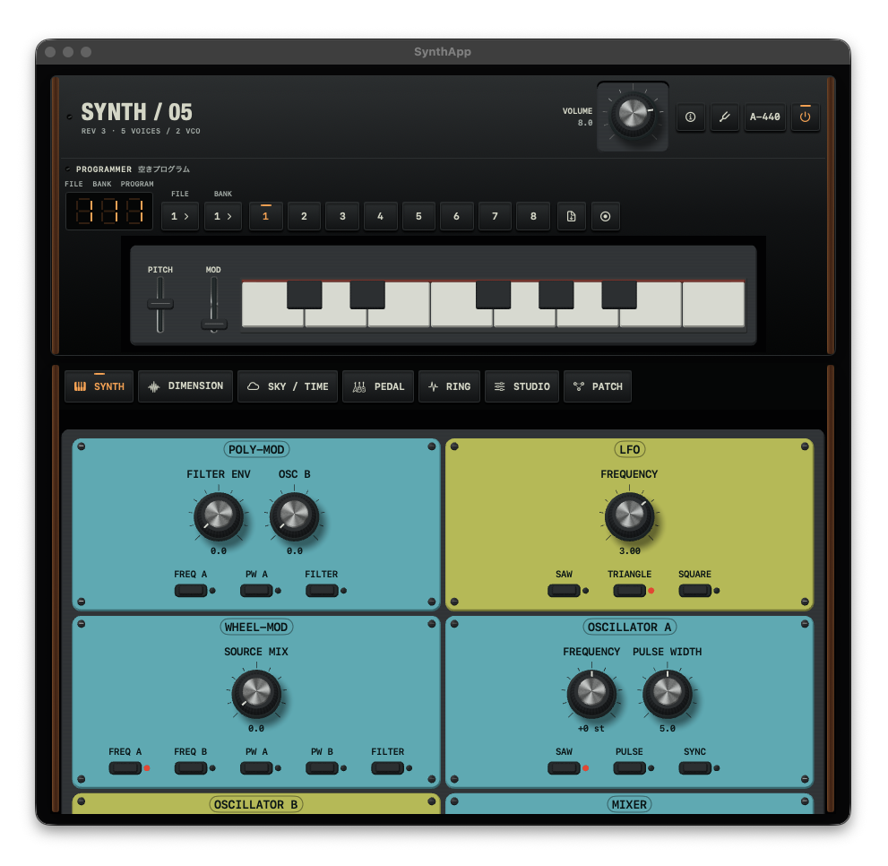
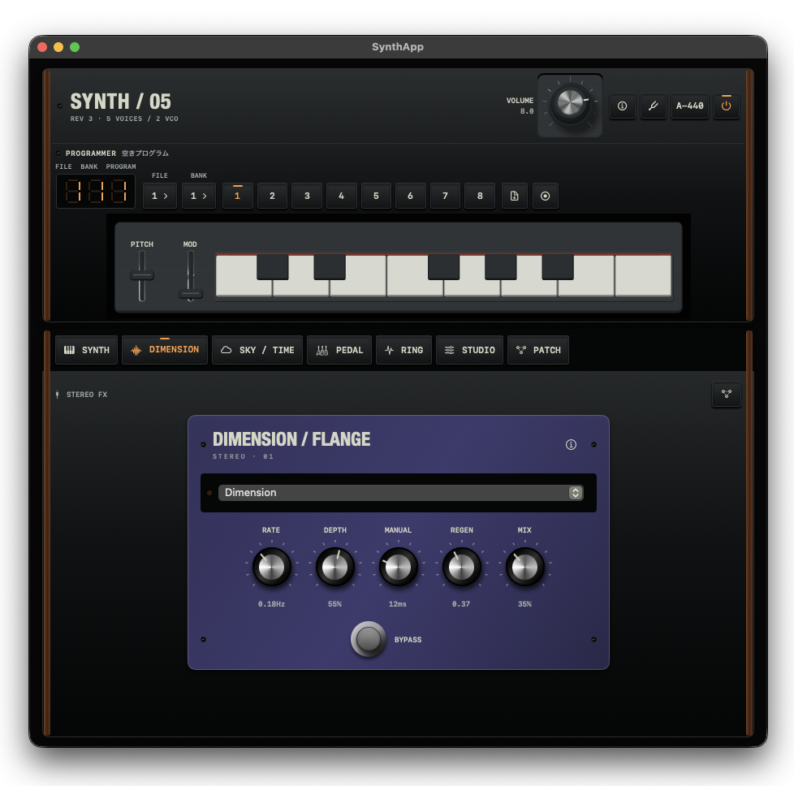
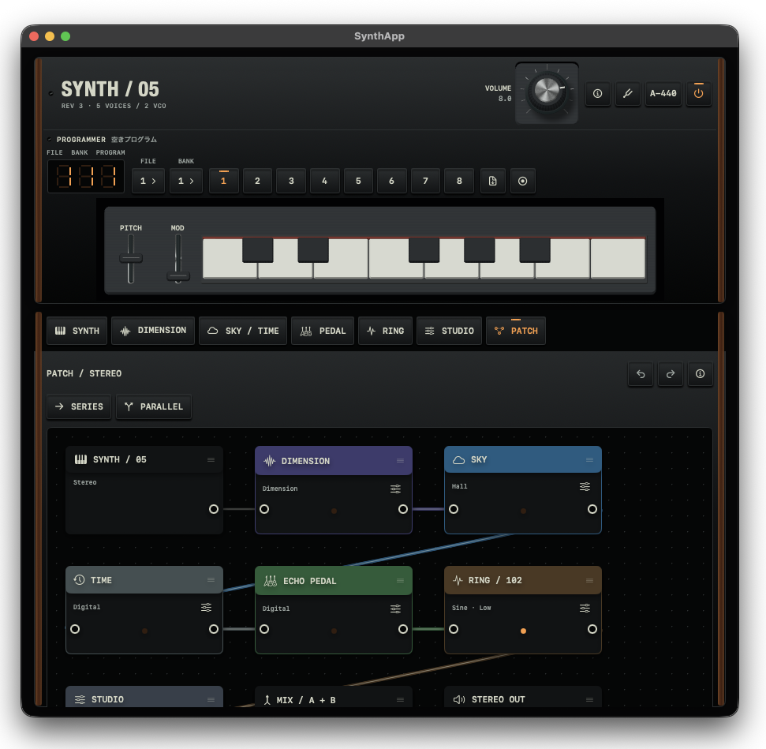

# Synth — 05 Rev3 inspired





SwiftUI / Metal / AUAudioUnitによる5ボイスの減算合成シンセです。参考画像のシアン／黄緑、金属キャップ付きノブ、黒い筐体を維持し、音色パラメーターをオリジナルRev3に統一しています。
A five-voice SwiftUI / Metal synthesizer with the original Rev3 voice controls and the supplied cyan/lime visual reference.
基于SwiftUI / Metal的五声部减法合成器，采用原版Rev3音色参数及参考图的青色／黄绿色设计。

## 現在のROADMAP / Current roadmap / 当前路线图（2026-11-09）

次の優先順位はこの節を参照してください。下の各節には実装履歴と測定条件を残しています。
Use this section for current priorities; subsequent milestones retain implementation history and measurement conditions.
当前优先级见本节，后续阶段保留实现历史与测量条件。

- 🟢 [Done] フィルター／飽和、EG時間精度、制御平滑化、RING／ディレイ／Sync／PWMの音質改善、局所ノイズPWM補正。
  Filter/saturation, envelope timing, control smoothing, RING/delay/sync/PWM quality and local noise-PWM correction.
  滤波／饱和、包络时间、控制平滑、RING／延迟／Sync／PWM音质与局部噪声PWM修正。
- 🟢 [Done] UI／GPU負荷を伴う120秒×変更前後の実出力検証と、Metal形状の差分更新。画像84状態が完全一致。
  Paired 120-second UI/GPU output tests and incremental Metal geometry; 84 pixel-identical states.
  完成修改前后各120秒的UI／GPU实际输出测试与Metal增量几何更新，84种状态像素完全一致。
- 🟢 [Done] 実出力のレート／ブロック列を再生する一致条件検証を追加。96kHz／512フレームで、オフラインの実経過時間超過とCPU予算超過を分離して記録。
  Added exact output-rate/frame-sequence replay; separated wall and CPU overruns at 96kHz/512 frames.
  新增实际输出采样率／帧序列重放，在96kHz／512帧下分别记录实际耗时与CPU预算超时。
- 🟢 [Done] FX経路変更を伴う180秒のUI／GPU負荷試験。33,750コールバック、90回のFX切替でDSP期限超過0。
  180-second UI/GPU stress with 90 FX switches: zero kernel overruns across 33,750 callbacks.
  180秒UI／GPU压力测试，90次效果切换、33,750次回调，音源超时0。
- 🟠 [Next] オフラインの待機有無・非CPU時間の追加切り分けと、LFO／ノイズ混合補正の配分。FX経路切替の音質検証。
  Compare paced/unpaced offline execution, attribute non-CPU time, refine mixed LFO/noise correction, and test FX-routing transition sound quality.
  比较离线定时／连续执行、细分非CPU耗时，改进LFO／噪声混合修正，并验证效果路由切换音质。
- 🟢 [Done] CoreMIDI自動接続、DAW入力先SYNTH/05、ノート／サステイン／Pitch／Mod、入力別保持と切断時解放。
  CoreMIDI auto-connect, SYNTH/05 DAW input, notes/sustain/wheels and per-input ownership/release.
  CoreMIDI自动连接、SYNTH/05 DAW输入、音符／延音／轮控及独立保持／断开释放。
- 🟢 [Done] MIDIベロシティ音量、ユニゾンの強度復帰、再利用ボイスの1ms平滑化。最大強度と画面鍵盤は従来音量。
  MIDI velocity gain, unison dynamics recall and 1ms reused-voice smoothing; maximum/default screen-keyboard level preserved.
  MIDI力度音量、齐奏力度恢复及复用声部1ms平滑，最大力度／屏幕键盘默认音量保持不变。
- 🟢 [Done] AUv3拡張とホストMIDI／状態保存／50パラメーター。UNGEを参考にしたノードの視認性・選択状態・接続表現。
  AUv3 hosting/state/50 parameters and UNGE-inspired node/port/cable presentation.
  AUv3宿主／状态／50项参数，以及参考UNGE的节点／端口／线缆表现。
- 🔴 [Later] 安定した標準音を保持する調整可能なボイス個体差、並列経路の遅延補償、FXプリセット／長時間ループ保存。
  Adjustable voice variation with stable defaults, parallel-path latency compensation, portable FX presets and long-loop persistence.
  保留稳定默认音色的可调声部差异、并行路径延迟补偿、效果预设与长循环保存。
- ⭕️ [Pending] iPhone実機の操作／負荷／音切れと、実機録音に基づく音色校正。
  Physical iPhone interaction/load/dropout and hardware-recording sound calibration.
  iPhone实机交互／负载／断音及硬件录音音色校准。

## Audio Unit / オーディオユニット / 音频单元

🟢 [Done] AUv3インストゥルメントを追加。既存UI、SYNTH/05表記、MIDIベロシティ／サステイン、FXを維持し、50項目のAUパラメーター、セッション保存、独立した複数インスタンスに対応します。Xcodeの **SYNTH05-macOS**／**SYNTH05-iOS** スキームでアプリと拡張をビルドできます。

AUv3 instrument with the existing UI, MIDI dynamics/sustain, FX, 50 host parameters, session state and independent instances. Build the matching app/extension using the Xcode schemes. SwiftPM remains the standalone application.

新增AUv3乐器，保留现有UI、MIDI力度／延音与效果，支持50项宿主参数、工程状态与独立多实例。通过Xcode方案构建父应用及扩展；SwiftPM仍构建独立应用。

[使い方・検証範囲 / Build and verification / 构建与验证](docs/audio-unit/README.md) · [Xcode project](Synth05.xcodeproj)

[ノード画面 / Node view / 节点视图](docs/images/patch-unge.png) · [狭幅 / Narrow view / 窄屏](docs/images/patch-unge-320.png)

## MIDI入力 / MIDI input / MIDI输入

🟢 [Done] 電源ONでCoreMIDI入力を自動接続し、起動後の接続・切断にも追従します。USB／システムに登録済みのMIDI入力は全チャンネルを共通の5ボイス音源へ受信。DAWの送信先には仮想入力 **SYNTH/05** を選べます。接続数とエラーは既存のInfoアイコン内に表示します。OS側でのBluetooth／ネットワークMIDI接続設定画面は追加していません。

Power on to automatically connect CoreMIDI sources, including sources added later. All channels feed the same five-voice instrument. A virtual **SYNTH/05** destination accepts DAW MIDI; the existing Info popover shows source count/errors. Bluetooth/network sessions must already be established through the system; there is no pairing UI.

开机后自动连接CoreMIDI输入并跟随设备接入／移除，所有通道共用五声部音源。DAW可选择虚拟目标 **SYNTH/05**，现有Info中显示输入数量／错误。蓝牙及网络MIDI需先通过系统建立连接，本应用不提供配对界面。

| MIDI | 動作 / Action / 行为 |
| --- | --- |
| Note On / Off | 発音／離鍵。Velocity 0はNote Off。/ Play/release; velocity zero is Note Off. / 发音／松键，力度0作为Note Off。 |
| CC64 | チャンネル別サステイン / Per-channel sustain / 按通道延音 |
| Pitch Bend | 既存Pitchホイール、±7半音 / Existing wheel, ±7 semitones / 现有弯音轮，±7半音 |
| CC1 | 既存Modホイール / Existing Mod wheel / 现有调制轮 |
| CC121 | サステイン解除、操作元のPitch／Modを初期化 / Release sustain and reset owned wheels / 释放延音并重置该输入控制的轮控 |
| CC123 | 全離鍵（サステインを尊重） / All notes off, respecting sustain / 全部松键，遵循延音 |
| CC120 | サステインを破棄して離鍵（EGのReleaseは維持） / Clear sustain and release, retaining envelope release / 清除延音并松键，保留包络释音 |

同音は入力元／チャンネルごとに保持し、最後の入力が離すまで継続します。画面鍵盤とも独立して保持。入力削除・電源OFF・音色プリセット呼出時は保持状態をクリアし、切断元が操作したPitch／Modは中立へ戻します。入力イベントは既存の固定容量ノートキューへ渡し、音声コールバックにはMIDIの解析・接続管理を追加しません。操作面、SYNTH/05表記、音色形式は維持しています。

Notes are owned per source/channel and independently from the on-screen keyboard. Removed sources release their notes and reset their owned wheels. Power off/preset recall clears held state. Parsing and connection management stay outside the audio callback; notes use the existing bounded queue. The UI, branding and program format remain intact.

同音按输入源／通道独立保持，并与屏幕键盘分开；最后一个输入释放后才松键。移除输入会释放其音符并归零其控制的轮控，关机／预设调用会清除保持状态。解析与连接管理不进入音频回调，音符使用已有固定容量队列。保持UI、名称及保存格式。

MIDIベロシティ1〜127をボイス音量へ線形に反映します（最大値は従来と同じ音量）。画面鍵盤の標準発音も従来の音量を維持します。Pitch／Modは共通パラメーターです。MPE、MIDI Learn、プログラムチェンジ、タイムスタンプに基づくサンプル精度の予約演奏は対象外です。

MIDI velocities 1–127 linearly scale voice gain; maximum velocity and default on-screen playing preserve the previous level. Pitch/Mod are global. MPE, MIDI Learn, program changes and sample-accurate timestamp scheduling are not implemented.

MIDI力度1–127线性控制声部音量，最大力度及屏幕键盘默认音量与原先一致。弯音／调制为全局参数；未实现MPE、MIDI Learn、程序切换及按时间戳进行采样精度调度。

🟢 [Done] バイト解析／演奏状態回帰、CoreMIDI仮想入力ループバック（複数・長いパケット、接続／切断、DAW宛先、停止／再開）、AUオフラインでの画面鍵盤との同音保持・離鍵・輪控反映、アプリ全体ビルドを確認。

Parser/state, virtual CoreMIDI hotplug/packet/destination/restart tests, offline AU note ownership/releases/wheel publication and full app compilation passed. Tests: `Tests/MIDIRegression.swift`, `Tests/MIDILoopbackRegression.swift`, `Tests/MIDIEngineRegression.swift`.

已通过字节解析／演奏状态、虚拟CoreMIDI连接／数据包／目标／重启、离线AU音符保持／松键／轮控及完整应用构建验证。

⭕️ [Pending] 実機USB／Bluetooth MIDI、外部DAWとiPhone実機での演奏・遅延・抜き差し検証。
Physical USB/Bluetooth controllers, external DAWs and physical iPhone playing/latency/hotplug verification.
实体USB／蓝牙控制器、外部DAW与iPhone实机演奏／延迟／插拔验证。

## パラメーター / Parameters / 参数

**音色46項目 = ノブ24項目 + スイッチ22項目。** Master Tune・Volumeの2ノブ、Pitch・Modの2ホイール、Tune・A-440は音色保存の対象外です。
**46 stored settings = 24 pots + 22 switches.** Master Tune, Volume, both wheels, Tune and A-440 are live controls, excluded from voice programs.
**46个音色参数 = 24个旋钮参数 + 22个开关参数。** 总调音、主音量、两个控制轮、Tune和A-440不随音色保存。

| Section                  |  Knobs | Switches |
| ------------------------ | -----: | -------: |
| Poly-Mod                 |      2 |        3 |
| LFO                      |      1 |        3 |
| Wheel-Mod                |      1 |        5 |
| Oscillator A             |      2 |        3 |
| Oscillator B             |      3 |        5 |
| Mixer                    |      3 |        0 |
| Filter + envelope        |      7 |        1 |
| Amplifier envelope       |      4 |        0 |
| Glide / Release / Unison |      1 |        2 |
| **Program total**        | **24** |   **22** |

基準資料は[Sequential Circuits CM1000D（1982年2月）](https://synthfool.com/docs/SequentialCircuits/Prophet_Series/Sequential%20Circuits%20Prophet%205%20Owners%20Manual.pdf)です。第2章の操作説明と6-5〜6-6ページの24バイト保存形式を照合しています。メモリー構成はRev3.3の3ファイル×5バンク×8音色＝120枠です。初期Rev3の40枠とは区別します。工場音色の複製は含みません。
The reference is the original CM1000D manual, section 2 and the 24-byte program table on pages 6-5–6-6. Memory follows Rev3.3: 3 files × 5 banks × 8 programs = 120 slots; earlier Rev3 units had 40. Factory patches are not bundled.
依据原版CM1000D说明书第2章及6-5至6-6页的24字节音色格式。存储采用Rev3.3的120个位置；早期Rev3为40个，不附带工厂音色。

## 実装 / Implementation / 实现

- 🟢 [Done] 補正の聴き比べ用にピアノ／バイオリンのシンセ音色を追加。PROGRAMMERの読込アイコン（書類＋下矢印）から選べます。ピアノは速い打鍵と減衰、バイオリンは滑らかな立ち上がりと持続音。FINE=0、ノイズ／ユニゾンなしで読み込み、Pitch／ModホイールとA-440を中立化します。主音量とマスターチューンは維持。ユーザー音色枠は上書きせず、保存する場合だけ録音ボタンを使います。FX設定は維持するため、補正確認時はFXをOFFにしてください。これは減算合成による楽器風音色です。
  Piano and Violin synth presets are available from PROGRAMMER's document/down-arrow recall menu. Piano tests attack/decay; Violin tests sustained stability. Recall uses FINE=0, no noise/unison, neutral wheels and A-440 off, preserving master volume/tuning. User slots are only written with Record. Bypass FX when comparing; these are subtractive synth interpretations.
  从PROGRAMMER的文档下箭头菜单选择钢琴／小提琴合成音色。钢琴用于检查起音与衰减，小提琴用于检查持续音稳定性。FINE=0、关闭噪声／齐奏，轮控归零且A-440关闭，保留主音量与总调音。仅按保存按钮才写入用户音色位。比较时请关闭效果；音色采用减法合成。

  [ピアノ / Piano / 钢琴](Previews/piano-preset.wav) · [バイオリン / Violin / 小提琴](Previews/violin-preset.wav) — FXなし、10.8秒／13.76秒。 / Dry, 10.8 / 13.76 seconds. / 干声10.8／13.76秒。

- 🟢 [Done] FINE=0で長く伸ばした音の安定性を改善。同じボイス内のOSC A/Bで自然な音程変動・トラッキング誤差・Tune補正を共有し、微小な音程差が積み重なって生じる音量のうねりを抑えます。5ボイスは別々に緩やかに揺れ、フィルター／ADSR／VCAの個体差も維持します。FINEや変調、ユニゾンで意図的に生じるうなりは残ります。新しい操作項目や保存音色の書き換えはありません。
  Improved long-note stability at FINE=0 by sharing incidental pitch drift, tracking error and Tune correction between A/B within each voice. Five voices retain separate slow motion and filter/envelope/VCA tolerances. Intentional Fine, modulation and unison beating remain; no added controls or saved-patch rewrites.
  改善FINE=0时的长音稳定性：同一声部的A/B共享自然音高漂移、跟踪误差与Tune校正，避免微小频差累积造成音量起伏。五个声部仍各自缓慢漂移，保留滤波器／ADSR／VCA差异；FINE、调制和齐奏产生的拍频仍保留。不增加参数，也不改写已存音色。

- 🟢 [Done] FXなしの単音で目立つ速いうなりを軽減。初期OSC B FINEを0セントにし、独立した音程揺れを小さく・ゆっくりに調整しました。遅い温度変動と自由走行する発振器は維持します。保存済み音色のFINEは変更しないため、既存音色ではOSC B FINEを0にして確認してください。意図的なデチューンによるうなりは残ります。
  Reduced rapid dry-note beating: neutral initial OSC B FINE, smaller/slower independent pitch wander, retained slow thermal motion and free-running phases. Saved patches retain their FINE value; set OSC B FINE to 0 when checking an existing patch. Intentional detuning still beats naturally.
  减轻干声单音的快速拍频：初始OSC B FINE设为0，减小并放慢独立音高漂移，保留缓慢温度变化与自由运行相位。已存音色的FINE不变，检查旧音色时请将OSC B FINE设为0；有意失谐仍会产生自然拍频。

- 🟢 [Done] 演奏中のプツプツ音への対策：通常のXcode Run／DebugビルドでもSwift DSPを最適化し、音声コールバックのパラメーター取得とノート受信を非待機化。ノートキューは256イベントの固定容量、押鍵状態は固定ビット列で管理します。ロック競合中も直前の音色で演奏を継続し、保留した離鍵は次に受信できたブロックで処理します。揺れ・共振・プリセットの値は変更しません。
  Crackle fix: optimize Swift DSP in normal Xcode Run/Debug builds and remove waiting for parameter/note locks from render. A fixed 256-event queue and MIDI-key bitset replace growing collections. Contention keeps the last valid patch playing and defers queued note-offs. Timbre and saved programs are unchanged.
  修复演奏爆音：普通Xcode Run／Debug构建也优化Swift DSP，音频回调不再等待参数／音符锁。采用固定256事件队列和按键位集；锁冲突时继续使用上一份有效音色，稍后处理保留的松键事件，不改变音色与预设。

- 🟢 [Done] 音源のアナログ挙動を改良。10発振器を離鍵中も動かし、独立した緩やかな音程変動、5ボイスのフィルター／ADSR／VCA差、Tune補正、CVベースのGlideを実装。44.1／48kHzでは音源全体を4倍、88.2／96kHzでは2倍で処理し、FIRで折り返しを抑制します。フィルターの非線形帰還、自己発振、パルスのDC除去と4msの主要コントロール平滑化も追加。操作項目は同じ46項目です。
  Free-running VCOs, independent slow pitch drift, per-card filter/envelope/VCA tolerances, tuning correction and pitch-CV glide. The complete voice path runs at 4× for 44.1/48 kHz and 2× for 88.2/96 kHz, followed by FIR decimation. Nonlinear filter feedback, self-oscillation, DC removal and 4 ms smoothing of main timbre controls are included; the 46-setting format is unchanged.
  新增自由运行振荡器、独立缓慢音高漂移、声部间滤波器／包络／VCA差异、调音补偿与音高CV滑音。44.1／48kHz采用4倍、88.2／96kHz采用2倍全音源过采样并通过FIR降采样，改善非线性反馈、自激振荡、直流消除及主要音色控制平滑处理；仍为46个音色参数。

  [ドライ試聴 / Dry demo / 干声试听](Previews/rev3-analog-demo.wav)：ブラス → ユニゾンベース → Syncリード → Poly-Modベル。FXなし、16.27秒。揺れ軽減前の参考録音です。 / No FX, 16.27 seconds; recorded before the beating adjustment. / 无效果，16.27秒；拍频调整前的参考录音。

- 🟢 [Done] マスター音量を共通タイトル帯へ移設し、全エフェクト画面から操作可能に。元と同じMetalノブ形状・描画倍率・操作感度を維持し、シンセ操作面の重複ノブを削除。狭い幅ではタイトル／操作ボタンの右側へ縦配置し、288pt幅の共通パネル高は327ptを維持。
  Master volume now lives in the shared header across all FX tabs. Its Metal mesh, projected size and drag sensitivity are unchanged; the duplicate synth control is removed. Narrow layouts place it beside the title/utilities.
  将主音量移到所有效果标签共用的标题栏，保持Metal旋钮形状、绘制比例和操作灵敏度，移除合成器区域的重复旋钮。窄屏放在标题与操作按钮右侧。

- 🟢 [Done] 共通パネルを再圧縮。広い画面ではPROGRAMMERと鍵盤を横並びにし、音色ボタンは4×2段、狭い画面は8ボタン1列を維持。保存／読込を空きスペースへ移動し、鍵盤とボタンのサイズを保って、5幅で高さを約15〜31%短縮（1088pt幅：326→226pt、288pt幅：388→327pt）。
  A tighter shared panel places programmer and keyboard side by side on wide screens. Program keys use two rows on desktop and one row on narrow screens; control sizes stay intact. Panel height drops about 15–31% across five widths.
  重新压缩共用面板，宽屏将音色区与琴键并排，音色按钮宽屏4×2排列、窄屏单行8个。保持琴键与按钮尺寸，五种宽度下面板高度减少约15–31%。

- 🟢 [Done] タイトル帯のInfo／Tune／A-440／電源、PROGRAMMER、Metal鍵盤とPitch／Modを、タブ外の共通パネルへ統合。音色選択・保存・演奏は全タブで共通。スクロールする操作面から分離し、高さの低い画面では共通パネル内もスクロールしてSafe Areaに収めます。
  One persistent panel combines header utilities, programmer, Metal keyboard and wheels across all tabs. Only the selected workspace changes; short viewports allow scrolling inside the common panel.
  将标题栏功能、音色选择与保存、Metal琴键及控制轮合并为所有标签共用的固定面板。仅切换下方工作区，较矮的窗口允许面板内部滚动以适应安全区域。

- 🟢 [Done] 黒い金属筐体、木目サイド、固定ネジ、銘板、通気スリット、鍵盤の赤いフェルトを追加。音色選択部はアンバー色7セグ表示と立体ボタンに統一し、狭い画面では段組みを変更。FILE／BANKはクリックで送り、右クリック／長押しで直接選択。
  Metal enclosure, wooden sides, screws, nameplate, vents and red keyboard felt. The responsive programmer uses amber seven-segment digits and beveled buttons; click FILE/BANK to advance or use the context menu to select directly.
  新增黑色金属外壳、木纹侧板、螺丝、铭牌、散热槽及键盘红色毛毡。音色区采用琥珀色七段显示与立体按钮，窄屏自动换行；点击FILE／BANK切换，右键或长按直接选择。

- 🟢 [Done] ノブ／スイッチの寸法と描画倍率を維持し、見出し・ノブラベル・数値・スイッチ名の縦間隔を調整。見出しとノブラベル、数値とスイッチ名の間は検証対象幅で4pt以上を確保し、隣接するノブラベルも幅を制限して接触を防止。
  Control sizes and projection stay unchanged. Section/knob labels and value/switch labels have at least 4pt vertical clearance at the tested widths; bounded label widths keep neighboring legends apart.
  保持旋钮／开关尺寸与绘制比例，调整标题、旋钮标签、数值和开关名称的纵向间距。在测试宽度下保留至少4pt纵向空隙，并限制相邻标签宽度以避免接触。

- 🟢 [Done] 独立した波形スイッチ、半音刻み4オクターブのOSC周波数、OSC B Fine 0〜100cent、Poly-Mod共通ソースと3送り先、Wheel-ModのLFO／ピンクノイズ混合。
  Independent summed shapes, four-octave semitone tuning, B fine 0–100 cents, shared Poly-Mod sources and all destinations, LFO/pink-noise Wheel-Mod.
  独立波形叠加、四八度半音调谐、B微调0–100音分、Poly-Mod共同源和全部目标、LFO／粉红噪声调制。
- 🟢 [Done] 最低音優先ユニゾン、ユニゾン時のみのGlide、Releaseスイッチ、A-440基準音、モノラル音源を両チャンネルへ出力。Rev3にないSub／Drive／Drift／Velocity／Filter Mode等の操作項目を削除。
  Lowest-note unison, unison-only glide, release enable, A-440 and dual-mono output. Non-Rev3 controls removed.
  最低音优先齐奏、仅齐奏滑音、释音开关、A-440及双声道单声输出，移除Rev3之外的控制项。
- 🟢 [Done] 26ノブ、22スイッチ、2ホイールをMetalで表示。画面幅に合わせ1／2／3列へ変更。Safe Area、左右16pt、英語／日本語／简体中文のヘルプと詳細編集。
  Metal controls reflow across one, two or three columns with safe areas, 16pt margins and localized help/editor.
  Metal控件自适应为一／二／三列，保留安全区域、16pt边距及三语言帮助和编辑器。
- 🟢 [Done] 46項目の厳密な保存・復元。旧A/Bプリセットはファイル1/2へ読み込み時に変換し、元データを保持。非対応の波形・効果を含む旧音色は完全互換ではありません。
  Strict 46-setting program format. Legacy A/B programs can be adapted into files 1/2 without overwriting originals; unsupported old sounds cannot be reproduced losslessly.
  严格保存46项参数，旧A/B音色载入文件1/2时适配且保留原数据；不兼容音色无法无损复现。
- 🟢 [Done] Syncの分数時刻エッジ補正と音源内部レートの倍増を実装。検証条件は下記「Modulation quality」を参照。
  Fractional sync edge correction and doubled voice rate are implemented; see the quality probes below. 已实现分数Sync边沿修正与音源内部速率倍增，验证条件见下文。
- 🟠 [Next] 高品質処理のCPU最適化、極端な変調／動的パルス幅で残る折り返しの追加検証。
  CPU optimization and further residual alias evaluation under extreme modulation and moving PWM. CPU优化及极端调制、动态脉宽的残余混叠评估。
- 🔴 [Later] 実機録音による周波数、時間定数、飽和特性の校正。
  Hardware-based response calibration. 根据实机录音校准响应。
- ⭕️ [Pending] iPhone実機のタッチ、マルチタッチ、GPU／CPU負荷、実機Rev3との聴感比較。
  Physical iPhone interaction/load tests and hardware listening comparison. iPhone实机交互／负载及实机听感对比。

項目の一致とアナログ回路の完全再現は別です。DSPはCEM3340／3310／3320の構成を参考にした挙動モデルで、実機の部品値を測定した回路シミュレーターではありません。揺れ・個体差・飽和量は控えめな近似値で、時間定数やノブ応答の実機校正は未実施です。詳細と検証値は[specification.md](specification.md#analog-voice-refinement-2026-10-22)を参照してください。
This is a behavioral model informed by the CEM3340/3310/3320 architecture, not a measured circuit simulation. Drift, tolerances and saturation use restrained approximations; time constants and knob responses still need hardware calibration. See the specification for measurements and limits.
这是参考CEM3340／3310／3320结构的行为模型，并非基于实测元件的电路仿真。漂移、个体差异与饱和度采用适度近似，时间常数及旋钮响应尚未经过实机校准。测量结果与限制见规范文档。

## 実行・検証 / Run and validate / 运行与验证

Xcodeで`Package.swift`を開いて実行します。 / Open `Package.swift` in Xcode. / 在Xcode中打开`Package.swift`。

```sh
CLANG_MODULE_CACHE_PATH=/tmp/synth-clang-cache SWIFTPM_MODULECACHE_OVERRIDE=/tmp/synth-swift-cache swift build --disable-sandbox
cat Sources/SynthApp/Rev3Parameters.swift Sources/SynthApp/EffectsGraph.swift Sources/SynthApp/EffectsDSP.swift Sources/SynthApp/ProphetCore.swift Tests/Rev3Regression.swift Tests/AudioRegression.swift Tests/AnalogRegression.swift > /tmp/synth-regression.swift
swiftc -O -module-cache-path /tmp/synth-clang-cache /tmp/synth-regression.swift -o /tmp/synth-regression
/tmp/synth-regression
cat Sources/SynthApp/Rev3Parameters.swift Sources/SynthApp/MetalPanelRenderer.swift Tests/MetalPanelRegression.swift > /tmp/synth-metal-check.swift
swiftc -module-cache-path /tmp/synth-clang-cache /tmp/synth-metal-check.swift -o /tmp/synth-metal-check
/tmp/synth-metal-check
```

通常のDebugビルドにも`-O`を適用しています。Xcodeから通常どおり停止→実行することで修正が反映されます。デバッグシンボルは維持しますが、最適化によって変数の参照やステップ実行が制限される場合があります。Releaseビルドも利用できます。
Normal Debug builds now use `-O`; stop and run again in Xcode to load the fix. Debug symbols remain, but optimized variables/stepping may be limited. Release remains available.
普通Debug构建现已使用`-O`，在Xcode停止后重新运行即可加载修复。保留调试符号，但优化可能限制变量查看与单步调试，仍可使用Release构建。

```sh
CLANG_MODULE_CACHE_PATH=/tmp/synth-clang-cache SWIFTPM_MODULECACHE_OVERRIDE=/tmp/synth-swift-cache swift build -c release --disable-sandbox
.build/release/SynthApp
```

試聴ファイルの再生成 / Regenerate the demo / 重新生成试听：
```sh
cat Sources/SynthApp/Rev3Parameters.swift Sources/SynthApp/EffectsGraph.swift Sources/SynthApp/EffectsDSP.swift Sources/SynthApp/ProphetCore.swift Tests/Rev3Regression.swift Tests/AnalogDemo.swift > /tmp/synth-analog-demo.swift
swiftc -O -module-cache-path /tmp/synth-clang-cache /tmp/synth-analog-demo.swift -o /tmp/synth-analog-demo
/tmp/synth-analog-demo /tmp/rev3-analog-demo.wav
```

音切れ対策の回帰検証 / Realtime regression / 实时回归验证：
```sh
cat Sources/SynthApp/Rev3Parameters.swift Sources/SynthApp/EffectsGraph.swift Sources/SynthApp/EffectsDSP.swift Sources/SynthApp/ProphetCore.swift Tests/Rev3Regression.swift Tests/RealtimeRegression.swift > /tmp/synth-realtime-regression.swift
swiftc -Onone -g -O -module-cache-path /tmp/synth-clang-cache /tmp/synth-realtime-regression.swift -o /tmp/synth-realtime-regression
/tmp/synth-realtime-regression
```

音源テストは44.1/48/96kHzの安定性、ADSR、波形併用、最低音優先、Release、変調経路、A-440、保存項目数と非保存コントロールの維持を検査します。GPUテストは288／343／382／736／1100pxで描画し、状態変化と領域内配置を確認します。GPUチェックにはMetalデバイスへのアクセスが必要です。
Audio tests cover sample-rate stability and Rev3 behaviors/schema; GPU tests cover five widths, bounds and visible state changes. GPU access is required.
音频测试覆盖多采样率稳定性、Rev3行为及参数格式；GPU测试检查五种宽度、边界及状态变化，需要GPU访问权限。

`Rev3Parameters.swift`がパネル・DSP・保存の共通定義、`MetalPanelRenderer.swift`がメッシュ、`InstrumentPanel.swift`が印字と操作を担当します。iPhone SE (3rd generation)／iPhone 16 Pro MaxのSwiftUI Previewを含みます。

## エフェクト / Effects / 效果

🟢 [Done] タブはSYNTH → DIMENSION → SKY / TIME → PEDAL → RING → STUDIO → PATCHの順です。初回は全エフェクトがバイパス。各モジュールのフットスイッチで有効にし、上部の共通鍵盤で試奏できます。
Tabs follow the requested order. Effects start bypassed; engage their footswitches and audition with the keyboard.
标签按请求顺序排列，首次启动全部效果旁通。点击脚踏开关启用，用上方共用琴键试听。

| Tab | Implemented independent DSP |
| --- | --- |
| DIMENSION | Stereo multi-voice chorus, positive/negative feedback flanger |
| SKY / TIME | Hall / Plate / Cloud / octave Shimmer; Digital / Tape / Bucket / Ping-pong delay, tap tempo |
| PEDAL | Digital / Tape / overlapping-grain Reverse delay; stereo 12-second record/play/overdub looper, reverse, half-speed, A/B/C recall/store |
| RING | Sine carrier, low/high frequency ranges, sine/triangle LFO, amount, drive, wet/dry |
| STUDIO | SCF-inspired chorus/flange; 2290-inspired ducking stereo echo |
| PATCH | Source + six effects + MIX A/B + OUT; port connections, disconnection, node dragging, series/parallel presets, undo/redo |

🟢 [Done] UNGEの型付き接続・DAG・CommandのSwift移植を使用。元コードとMITライセンス、移植範囲は[Vendor/UNGE/INTEGRATION.md](Vendor/UNGE/INTEGRATION.md)に保存。音声用の事前確保バッファと処理順をAudioUnitへ接続し、マスター音量はエフェクト後へ適用しています。
A Swift port of UNGE's graph/command core validates routing. A precompiled audio plan processes host-owned stereo buffers; master volume follows the effects.
使用UNGE图与命令核心的Swift移植进行连接验证，预编译处理顺序并预分配立体声缓冲，主音量位于效果之后。

出力ポート→入力ポートの順で選択。入力の右クリック／長押し、またはケーブル一覧から切断します。並列経路はMIX A/Bで合流。各入力は1本、未接続入力は無音、循環接続は拒否します。9個の固定ノードを並べ替えて接続する構成で、同一エフェクトの複数インスタンス生成には未対応です。
Select an output, then an input. Disconnect through a port's context menu or cable list. Merge parallel branches with MIX A/B. Inputs accept one cable, disconnected inputs are silent, cycles are rejected. The nine nodes are fixed; duplicate effect instances are not implemented.
先选输出再选输入，通过端口菜单或连线列表断开，用MIX A/B合并并行分支。每个输入仅允许一条连线，未连接为静音，禁止循环。当前为九个固定节点，不支持同类效果的多个实例。

設定・接続・配置は自動保存され、Rev3の音色46項目から独立しています。ルーパー音声はRAM内のみで、電源停止時に消去されます。プリセット操作で録音を開始することはありません。各実機の全機能・全アルゴリズムや音響特性を再現したものではありません。
FX settings/routing/placement save separately from Rev3 programs. Loops live only in RAM and clear when power stops; preset recall cannot trigger recording. These are original inspired algorithms, not full hardware emulations.
效果设置、连接与位置独立自动保存，循环音频仅存在于RAM并在停止电源时清除，预设不会触发录音。这些为参考实机的独立算法，并非完整仿真。

```sh
cat Sources/SynthApp/EffectsGraph.swift Sources/SynthApp/EffectsDSP.swift Tests/EffectsRegression.swift > /tmp/synth-effects-tests.swift
swiftc -O -parse-as-library -module-cache-path /tmp/synth-clang-cache /tmp/synth-effects-tests.swift -o /tmp/synth-effects-tests
/tmp/synth-effects-tests
cat Sources/SynthApp/Rev3Parameters.swift Sources/SynthApp/EffectsGraph.swift Sources/SynthApp/EffectsDSP.swift Sources/SynthApp/ProphetCore.swift Tests/EffectsIntegration.swift > /tmp/synth-fx-integration.swift
swiftc -O -parse-as-library -module-cache-path /tmp/synth-clang-cache /tmp/synth-fx-integration.swift -o /tmp/synth-fx-integration
/tmp/synth-fx-integration
cat Sources/SynthApp/EffectsGraph.swift Sources/SynthApp/EffectsController.swift Tests/EffectsControllerRegression.swift > /tmp/synth-fx-host.swift
swiftc -parse-as-library -module-cache-path /tmp/synth-clang-cache /tmp/synth-fx-host.swift -o /tmp/synth-fx-host
/tmp/synth-fx-host
```

🟢 [Done] 44.1/48/96kHzの各モード、残響、ステレオ差、最大フィードバック、ルーパー、グラフ契約、AU経由の処理／ミュート／OUT切断を検証。5幅の画面描画、macOSでのポート接続・Undo・並列接続を確認。
Verified modes/tails/stereo/feedback/looper at three sample rates, graph contracts and AU routing/mute/disconnection; rendered five UI widths and exercised macOS patch editing.
已验证三种采样率的模式／尾音／立体声／反馈／循环录音，以及图契约和AU连接／静音／断开；检查五种界面宽度及macOS节点编辑。

🟢 [Done] RINGの歪み・音声帯域変調を4倍オーバーサンプリングし、FIRで折り返しを抑制。詳細と検証条件は下記「RING antialiasing」。 RING drive/modulation now use 4x oversampling and FIR antialiasing; see validation below. RING驱动与调制已采用4倍过采样和FIR抗混叠，验证条件见下文。
🟢 [Done] 高速ディレイの速度適応sinc補間、Syncのエッジ補正、Poly-Mod向け内部レート向上を実装（下記参照）。 Speed-adaptive sinc delay reads, fractional sync edge correction and higher internal modulation rates are implemented; see below. 已实现速度自适应sinc延迟读取、Sync边沿修正及更高调制内部速率，见下文。
🔴 [Later] 同一エフェクトの複数インスタンス、独立したFXプリセットファイル、長時間ループ保存。 Multiple instances, portable FX preset files and persistent long loops. 多实例、独立预设文件及长循环存储。
⭕️ [Pending] iPhone実機の操作／負荷／音切れ検証と、参考実機との聴感・測定比較。 Physical iPhone interaction/load/dropout and hardware comparisons. iPhone实机交互／负载／断音测试及参考设备对比。

参考にした公式資料： [Roland SBF-325](https://static.roland.com/manuals/sh-4d/jpn/50233808.html)、[Strymon TimeLine](https://www.strymon.net/support/timeline/)、[Strymon BigSky](https://www.strymon.net/get-know-bigsky-rabea-massaad-pt-3/)、[Line 6 DL4 MkII](https://line6.com/effects-pedals/dl4-mkii/)、[t.c. electronic 2290](https://www.tcelectronic.com/en/products/0815-aak)、[Moog MF-102 manual](https://api.moogmusic.com/sites/default/files/2018-06/MF_102_Ring_Modulator_Manual.pdf)。


楽器プリセット検証・試聴の生成 / Instrument preset checks and demos / 乐器预设验证与试听：
```sh
cat Sources/SynthApp/Rev3Parameters.swift Sources/SynthApp/EffectsGraph.swift Sources/SynthApp/EffectsDSP.swift Sources/SynthApp/ProphetCore.swift Tests/Rev3Regression.swift Tests/InstrumentPresetsRegression.swift > /tmp/synth-instrument-presets.swift
swiftc -O -module-cache-path /tmp/synth-clang-cache /tmp/synth-instrument-presets.swift -o /tmp/synth-instrument-presets
/tmp/synth-instrument-presets Previews
```

## Extended expression / 音の表現拡張 / 声音表现扩展

🟢 [Done] SYNTH上部のSYNTH/05 / Extendedで切り替え。初期状態はSYNTH/05。Extendedにはサイン波の1オクターブ下のサブ音源、独立したフィルター揺らぎ、オートパンと共通速度（0.05–8Hz）を追加。切り替えと各深度は4msで平滑化します。既存FXはどちらのモードでも独立して動作します。
Switch above the SYNTH panel. SYNTH/05 is the default; Extended adds a sine sub one octave below the played pitch, independent filter motion, and auto pan with a shared 0.05–8Hz rate. Depths and bypass use 4ms smoothing. Existing FX remain independent in both modes.
在SYNTH顶部切换，默认为SYNTH/05。Extended添加低一个八度的正弦波低音、独立滤波调制及自动声像，共用0.05–8Hz速率。深度和旁通采用4ms平滑处理，两种模式下原有效果均独立运行。

🟢 [Done] 拡張設定とモードはアプリ共通で自動保存し、SYNTH/05への切り替え中も保持。既存の46項目の音色保存・呼び出し・楽器プリセットはそのまま利用可能です。拡張値は音色スロットには含みません。
Extension settings and mode save globally and survive bypass. The original 46-setting programs and instrument presets retain their schema; extension settings are outside program slots.
扩展参数与模式全局自动保存，旁通时保留。原有46项音色及乐器预设格式保持不变，音色槽不包含扩展参数。

⭕️ [Pending] iPhone実機での新パネルのレイアウト、操作、負荷と聴感の確認。
New panel layout, interaction, load and listening checks on physical iPhones remain pending.
iPhone实机新面板布局、交互、性能与听感验证待完成。

```sh
cat Sources/SynthApp/Rev3Parameters.swift Sources/SynthApp/EffectsGraph.swift Sources/SynthApp/EffectsDSP.swift Sources/SynthApp/ProphetCore.swift Tests/Rev3Regression.swift Tests/ExpressionRegression.swift > /tmp/synth-expression-test.swift
swiftc -O -module-cache-path /tmp/synth-clang-cache /tmp/synth-expression-test.swift -o /tmp/synth-expression-test
/tmp/synth-expression-test
```

### Ladder color / ラダー系の音作り / 梯形滤波音色

🟢 [Done] ExtendedにLADDER（既存フィルターとの混合）、DRIVE（入力と出力の飽和）、FEEDBACK（各ボイスの4段目の出力を入力へ戻す量）、6／12／18／24dB/octの傾き切り替えを追加。既存のカットオフ、レゾナンス、フィルターEGと連動し、5音ポリフォニーを維持。LADDERを上げて使用します。初期値はLADDER／DRIVE／FEEDBACKすべて0。SYNTH/05で追加処理をバイパスし、設定は保持します。
Extended adds LADDER blend, DRIVE saturation, FEEDBACK from each voice's fourth filter stage, and 6/12/18/24dB/oct slopes. Raise LADDER to use the color path. Existing cutoff, resonance and filter envelope control both paths; five-voice polyphony remains. All three new knobs default to zero. SYNTH/05 bypasses the additions and retains settings.
Extended新增LADDER混合、DRIVE饱和、每个声部第四级输出的FEEDBACK反馈，以及6/12/18/24dB/oct斜率。提高LADDER即可使用。截止频率、共振和滤波包络共用，保留五音复音。三个新旋钮默认为0，SYNTH/05旁通新增处理并保留参数。

🟢 [Done] 新パラメーターは既存の拡張設定へ保存。旧形式の拡張設定は新項目を初期値で補完して読み込みます。既存の46項目の音色スロット形式は維持。音声処理は既存のオーバーサンプリング内で実行し、切り替え・深度・傾きを平滑化します。
Color settings save with expression settings, with defaults supplied when decoding older data. The original 46-setting voice schema is unchanged. The color path runs inside existing oversampling with smoothed controls.
新参数随扩展设置保存，旧数据缺少的新项按默认值补全。原有46项音色格式保持不变，滤波在现有过采样内运行并平滑控制变化。

🟢 [Done] 44.1／48／96kHzで全傾き、最大共振・歪み・フィードバック、ステレオ出力、SYNTH/05バイパス、旧設定の移行と既存音源の回帰テストを検証。アプリのビルドと288／343／398／1000pt幅のパネル描画を確認。
Verified slopes, maximum resonance/drive/feedback, stereo output, bypass, migration and existing audio regressions at three sample rates; built the app and inspected panel renders at four widths.
已验证三种采样率的斜率、最大共振／驱动／反馈、立体声输出、旁通、旧设置迁移及现有音源回归，完成应用构建与四种宽度的面板检查。

⭕️ [Pending] iPhone実機での負荷・操作・聴感、および参考実機との比較。
Physical iPhone performance, interaction, listening and reference hardware comparisons remain pending.
iPhone实机性能、交互、听感及参考硬件对比待验证。

参考 / Reference / 参考：[Moog Subsequent 37 official manual](https://api.moogmusic.com/sites/default/files/2017-09/Subsequent_37_Manual_0.pdf)。機能構成を参考にした独自DSPで、実機の回路・音響特性の完全再現ではありません。Original inspired DSP, not a circuit-accurate hardware emulation. 参考功能设计的独立DSP，并非硬件电路精确仿真。


## RING antialiasing / RINGの折り返し改善 / RING抗混叠（2026-11-06）

🟢 [Done] 既存RINGの歪みとキャリア乗算を4倍レートで処理。97タップのBlackman窓FIRとポリフェーズ補間／間引きを使用し、係数・固定長バッファは事前確保。UI・保存形式は維持。無効時は既存どおり入力サンプルをそのまま返します。
RING saturation and carrier multiplication run at 4x with a 97-tap Blackman-windowed FIR and polyphase interpolation/decimation. Coefficients and fixed buffers are prepared in advance; UI and saved data remain compatible, and settled bypass is sample-exact.
RING饱和与载波乘法采用4倍处理、97抽头Blackman窗FIR及多相插值／抽取。系数和固定缓冲预先准备，界面与保存格式兼容，旁通稳定后逐样本保持原信号。

🟢 [Done] RING内部の原音／処理音を24サンプルに整列（44.1kHz: 0.544ms、48kHz: 0.500ms、96kHz: 0.250ms）。有効時のMIX=0にもこの遅延が適用されます。PATCHで別の経路と並列に合流した場合、経路間の自動遅延補償は未実装です。
RING dry/wet paths align at 24 host samples, including MIX=0 while enabled. Separate parallel PATCH branches do not yet receive automatic path latency compensation.
RING内部干湿路径对齐至24个主机采样，有效时MIX=0也有此延迟；PATCH独立并行分支尚未自动补偿路径延迟。

🟢 [Done] 44.1／48／96kHz相当の正規化周波数による高域キャリア／高ドライブの固定信号で、測定対象の折り返し成分が従来の1倍処理より74.2／76.2dB低下。すべての入力・設定で同じ低減量を保証する測定ではありません。必要な側帯波、左右独立性、原音整列、バイパス復帰も検証。全FX回帰・AU統合テストを通過。
Fixed normalized-frequency high-carrier and high-drive probes measured 74.2/76.2dB less energy at the selected alias components versus the old 1x path; this is not a universal rejection specification. Wanted sidebands, channel isolation, latency alignment, bypass restoration, full FX regressions and AU integration passed.
固定归一化频率的高频载波与高驱动测试中，指定混叠分量较旧1倍处理降低74.2／76.2dB，并非所有信号和设置的保证值。有效边带、声道隔离、延迟对齐、旁通恢复、完整效果回归与AU集成均通过。

🟢 [Done] 開発Macで44.1／48／96kHz、64／128／256フレーム、FX有効／無効の各条件を検査し、ウォームアップ後の計1440ブロックで処理期限超過0。iPhoneの性能保証ではありません。
On the development Mac, all 1,440 measured post-warmup blocks met deadlines across three sample rates, three block sizes and FX on/off. Physical iPhone deadlines remain unverified.
开发Mac在三种采样率、三种块大小及效果开／关条件下，预热后共1440块未超时；iPhone实机期限尚待验证。

🟢 [Done] 高速ディレイ変調とSync／Poly-Modの第1段階の改善を実装。最新の検証・残作業は次節を参照。
The first fast-delay and Sync/Poly-Mod quality milestone is implemented; current validation and remaining work follow below.
已实现高速延迟及Sync／Poly-Mod第一阶段改善，最新验证与剩余工作见下节。
⭕️ [Pending] iPhone実機の音切れ・操作・負荷・聴感確認。
Physical iPhone dropout, interaction, load and listening checks remain pending.
iPhone实机断音、交互、性能与听感待验证。

```sh
cat Sources/SynthApp/EffectsGraph.swift Sources/SynthApp/EffectsDSP.swift Tests/RingAntialiasRegression.swift > /tmp/synth-ring-aa.swift
swiftc -O -parse-as-library -module-cache-path /tmp/synth-clang-cache /tmp/synth-ring-aa.swift -o /tmp/synth-ring-aa
/tmp/synth-ring-aa
```


## Modulation quality / 高速変調の音質改善 / 高速调制音质改善（2026-11-06）

🟢 [Done] TIME、PEDALのディレイ、STUDIOのエコーに32タップの窓付きsinc補間を導入。実際の読み出し速度からカットオフを選び、時間圧縮時の高域を読み出し時に抑制。位相・速度バンク間は連続補間し、係数は事前生成。Reverseもsinc補間を使用。従来のコーラス／フランジャー・残響の補間方式と、保存形式・UIは維持しています。
TIME, PEDAL delays and STUDIO echo now use 32-tap windowed-sinc reads. Actual read-head speed selects a lower cutoff during time compression, with interpolated phase/speed banks prepared in advance. Reverse reads also use sinc interpolation. Chorus/flanger/reverb interpolation, UI and persistence remain compatible.
TIME、PEDAL延迟及STUDIO回声采用32抽头窗函数sinc读取。按实际读取速度选择压缩时的低通截止频率，预生成的相位／速度表连续插值；反向读取也使用sinc。合唱／镶边／混响插值、界面与保存格式保持兼容。

🟢 [Done] OSC AのSyncは通常の波形エッジと途中リセットの不連続を、分数サンプル時刻に基づく2サンプルのpolynomial BLEPで補正。Saw／Pulse／併用を対象とします。Sync側OSC Aには内部1サンプル分の履歴を使用。Sync無効時は従来のオシレーター経路です。
Sync OSC A corrects ordinary waveform edges and partial-cycle resets with a two-sample polynomial BLEP at the fractional event time, covering saw, pulse and their sum. This uses one internal sample of history for synced OSC A; the non-sync oscillator path is retained.
Sync的OSC A采用分数采样事件时刻的双采样polynomial BLEP，修正普通波形边沿与中途复位，覆盖锯齿、脉冲及叠加。同步OSC A使用一个内部采样历史，非同步保留原振荡器路径。

🟢 [Done] 音源全体の内部レートを44.1／48kHzで8倍、96kHzで4倍、それより高いホストレートで2倍へ変更。深いPoly-Modを含むオシレーター・フィルター・VCAを高レートで処理し、既存FIRでホストレートへ戻します。音源のFIR遅延は従来どおり32ホストサンプル。グライド無効時は同じピッチ／鍵盤追従計算をホストサンプルごとにまとめ、負荷を削減。それでも高品質化のためCPU負荷は増えます。
The voice path now runs at 8x for 44.1/48kHz, 4x at 96kHz, and 2x at higher host rates. Oscillators, deep Poly-Mod, filters and VCAs share the higher rate before FIR decimation. FIR latency remains 32 host samples; CPU cost increases. When glide is inactive, unchanged per-voice pitch/keyboard calculations are cached once per host sample.
音源在44.1／48kHz采用8倍、96kHz采用4倍、更高主机采样率采用2倍内部处理。振荡器、深度Poly-Mod、滤波与VCA共用高采样率后经FIR抽取，FIR延迟保持32个主机采样。无滑音时按主机采样缓存不变的音高／键盘跟踪计算以降低负载，但高品质处理仍增加CPU成本。

🟢 [Done] 固定信号のテストで、2倍速ディレイ読み出しの対象の折り返し成分は約55.9dB低下。SyncのSaw／Pulse／併用では64倍参照に対する振幅スペクトルの二乗誤差が約97〜98%低下。同じ参照方式の指数周波数変調レート試験では4倍→8倍で約65%低下。Poly-Mod試験は内部レート効果を検査する合成信号で、実機やすべての音色の誤差を表すものではありません。有限長補間・BLEPは全条件での折り返し除去を保証しません。
Fixed probes measured ~55.9dB less selected alias energy for 2x delay reads, ~97–98% lower squared magnitude-spectrum error for corrected sync saw/pulse/sum versus a 64x reference, and ~65% lower error in a synthetic exponential-frequency modulation rate probe from 4x to 8x. These are specific offline probes, not hardware calibration or universal alias rejection guarantees.
固定测试中，2倍速延迟指定混叠分量降低约55.9dB；同步锯齿／脉冲／叠加对64倍参照的幅度谱平方误差降低约97–98%；合成指数频率调制的内部速率4倍→8倍测试误差降低约65%。这些为特定离线信号，非硬件校准或全条件抗混叠保证。

🟢 [Done] 全FXモード・最大フィードバック、AUルーティング／ミュート／切断、既存音源とアナログ挙動の回帰テストを通過。30秒サステインの全カード試験も通過。
FX mode/feedback, AU routing/mute/disconnection, voice and analog regressions passed, including all-card 30-second sustain checks.
效果模式／最大反馈、AU路由／静音／断开、音源与模拟行为回归及所有声部卡30秒持续音测试通过。

🟢 [Done] ピッチ計算の最適化前後を6種類の設定で比較し、出力ハッシュが完全一致。最終ビルド・音源／品質回帰も通過。全FXを有効にしてディレイ時間を交互に変更する負荷試験を追加し、開発Macで3レート×3ブロック長×FX有効／無効を測定。CPU時間の95パーセンタイルは全条件で期限内ですが、経過時間では計1440ブロック中7件の期限超過を記録しました。安定性の課題として継続します。
Six before/after pitch-cache render variants produced identical output hashes; final build, voice and quality regressions passed. The realtime probe now sweeps delay times with all FX engaged. Across three rates, three block sizes and FX on/off on the development Mac, all CPU p95 values were below their deadlines, but wall time exceeded deadlines in 7 of 1,440 measured blocks. Stability work remains open.
六种音高缓存优化前后渲染的输出哈希完全一致，最终构建、音源与质量回归通过。实时测试新增全效果开启时交替改变延迟时间。在开发Mac三种采样率、三种块大小及效果开关组合下，CPU时间p95均低于期限，但1440个测量块中仍有7个实际耗时超期，稳定性继续改善。

🟠 [Next] CPU負荷の最適化と、時間変化するパルス幅・さらに極端な変調での残留成分の評価。
Next: CPU optimization and residual artifacts under moving pulse width and more extreme modulation.
下一步：CPU优化及动态脉宽、更加极端调制的残余分量评估。
⭕️ [Pending] iPhone実機での音切れ・操作・CPU/GPU負荷・聴感確認。
Physical iPhone dropout, interaction, CPU/GPU load and listening checks remain pending.
iPhone实机断音、交互、CPU／GPU负载与听感待验证。

```sh
cat Sources/SynthApp/Rev3Parameters.swift Sources/SynthApp/EffectsGraph.swift Sources/SynthApp/EffectsDSP.swift Sources/SynthApp/ProphetCore.swift Tests/ModulationQualityRegression.swift > /tmp/synth-modulation-quality.swift
swiftc -O -module-cache-path /tmp/synth-clang-cache /tmp/synth-modulation-quality.swift -o /tmp/synth-modulation-quality
/tmp/synth-modulation-quality
```


## Filter response and gain staging / フィルター応答と飽和 / 滤波响应与饱和（2026-11-06）

🟢 [Done] Rev3系フィルターの各段に、信号レベルに依存する利得セルの圧縮近似を導入。低レベルの4極応答を維持しながら、大きな信号では各段の応答が変わるようにしました。段ごとの係数からフィードバック量を再計算し、既存のゼロ遅延非線形解法を維持。レゾナンスによる低域低下と自励発振も維持し、自動的な音量補正は加えていません。
The Rev3-style filter now approximates signal-dependent gain-cell compression per pole, preserving its small-signal four-pole response while changing driven behavior. Feedback is recalculated from the individual pole coefficients using the existing zero-delay nonlinear solve. Resonance-related bass loss and bounded self-oscillation remain; there is no automatic loudness compensation.
Rev3风格滤波器新增逐级信号相关增益单元压缩近似，保持小信号四极响应并改变大信号行为。按各级系数重算反馈，保留零延迟非线性求解、共振低频损失及有界自激，不加自动响度补偿。

🟢 [Done] ミキサー入力の飽和カーブを独立させ、低レベルの利得0.65を保ちながら入力ヘッドルームを少し広く設定。OSCを2基混ぜたときの入力レベルが飽和に反映されます。VCAはEGとボイス利得を適用した後に出力段を飽和させ、アタック／余韻の小音量部分では歪みが自然に減る構成に変更しました。ユーザー操作のマスター音量は従来どおりFX後段です。
Mixer saturation is separated with slightly more input headroom and the same 0.65 small-signal scaling. Summed oscillator levels determine overload. VCA envelope/card gain now precedes output-stage saturation, allowing quieter attack/release portions to retain headroom. User master volume remains after FX.
混音饱和独立建模，输入余量略增，小信号增益仍为0.65。振荡器叠加电平影响过载。VCA先施加包络与声部增益，再经过输出级饱和，使起音／释音的小音量部分失真减少。主音量仍在效果之后。

🟢 [Done] 画面、SYNTH/05表記、46項目の音色形式、Extendedの操作は維持。フィルターのレゾナンス強調・低域低下・入力圧縮・自励発振・極端な入力／カットオフ変化を176.4／192／352.8／384kHz内部レートで検証。ミキサーの低レベル透明性と過大入力の倍音増加、EGに応じたVCA倍音減少、無音ゲートも検証。音源・アナログ・全カード30秒サステイン・楽器プリセット・Extended／Ladder・AU統合の回帰テストを通過。アプリをビルド済み。
UI, SYNTH/05 branding, 46-setting programs and Extended controls are unchanged. Response, overload, self-oscillation and extreme-input/cutoff stability passed at four internal rates. Harmonic probes verify low-level transparency, overload harmonics, envelope-dependent VCA harmonics and silent gates. Voice/analog/long-sustain/preset/expression/ladder/AU regressions and app build passed.
界面、SYNTH/05标识、46项音色格式与Extended操作不变。四种内部采样率的响应、过载、自激与极端输入／截止变化稳定性通过。谐波测试验证低电平透明度、过载谐波、包络相关VCA谐波及零门控静音。音源／模拟／长持续音／预设／扩展／梯形滤波／AU回归与构建通过。

🟢 [Done] 最終の開発Mac負荷測定では、44.1／48／96kHz × 64／128／256フレーム × FX有効／無効の計1440測定ブロックで期限超過0。これは今回の実行結果で、以前の7件の期限超過の原因解決やiPhoneでの無音切れを保証するものではありません。
The final development-Mac run recorded zero deadline misses across 1,440 measured blocks (three rates, three block sizes, FX on/off). This run does not prove the earlier seven misses are resolved or certify physical iPhone performance.
最终开发Mac测量在三种采样率、三种块大小及效果开关组合共1440块中未超时。本次结果不证明此前七次超时原因已解决，也不保证iPhone实机性能。

比較用ドライ音声： [変更前](Previews/filter-color-before.wav) ／ [変更後](Previews/filter-color-after.wav)。単一Sawの和音→2OSCの和音→レゾナンススイープの順。各ファイル全体へ一定ゲインを適用してRMSを揃えています。ノートごとの正規化やFXはありません。これはソフトウェアの変更前後比較で、実機録音との比較ではありません。
Dry A/B clips play single-saw chords, two-oscillator chords, then a resonant sweep. One constant gain per complete clip matches overall RMS; no per-note normalization or FX. This compares software revisions, not reference hardware.
干声A/B依次为单锯齿和弦、双振荡器和弦及共振扫频。每个完整片段采用一个恒定增益匹配整体RMS，无逐音归一化或效果。此为软件版本对比，非硬件录音对比。

🟢 [Done] エンベロープの時間精度とADSR／Poly-Modの操作応答を改善（2026-11-07、次節参照）。
Envelope time accuracy and ADSR/Poly-Mod control response were refined; see the next milestone.
已改善包络时间精度与ADSR／Poly-Mod操作响应，见下一阶段。
⭕️ [Pending] 同一実機・同一設定のドライ録音による校正、実機との聴感比較、iPhone実機負荷確認。飽和係数と段ごとの圧縮は現時点では設計上の近似値です。
Matched hardware recordings, listening comparison and physical iPhone load validation remain pending. Saturation and per-pole compression coefficients are design approximations awaiting calibration.
匹配硬件设置的干声录音校准、硬件听感对比及iPhone实机负载待验证。饱和与逐级压缩系数目前为设计近似。

参考 / Reference / 参考： [Rev3 technical manual, mixer/filter/amplifier sections](https://www.synfo.nl/servicemanuals/Sequential/SEQUENTIAL_PROPHET-5-REV3_SERVICE_MANUAL.pdf), [CEM3320 datasheet](https://akizukidenshi.com/goodsaffix/CEM3320.pdf)。

```sh
cat Sources/SynthApp/Rev3Parameters.swift Sources/SynthApp/EffectsGraph.swift Sources/SynthApp/EffectsDSP.swift Sources/SynthApp/ProphetCore.swift Tests/FilterColorRegression.swift > /tmp/synth-filter-color.swift
swiftc -O -module-cache-path /tmp/synth-clang-cache /tmp/synth-filter-color.swift -o /tmp/synth-filter-color
/tmp/synth-filter-color
```


## Envelope timing and control response / EG時間精度と操作応答 / 包络时间精度与操作响应（2026-11-07）

🟢 [Done] EG内部の積分状態をDoubleに変更し、長いアタック／ディケイ／リリースの丸め誤差を抑制。出力は従来どおりFloat。30秒アタックはテストした44.1／48／96／352.8／384kHzで30.000000〜30.000021秒。係数の時間定義、1ms〜30秒のノブ範囲、指数カーブ、現在の電圧からの再発音は維持しています。
Envelope capacitor integration now uses Double to reduce rounding error for long attack/decay/release times, while DSP output remains Float. A 30s attack measured 30.000000–30.000021s across the five tested rates. Existing coefficient time definitions, 1ms–30s knob ranges, exponential curves and retrigger-from-current-voltage behavior remain.
包络电容状态改用Double积分，降低长起音／衰减／释音的舍入误差，DSP输出仍为Float。五种测试采样率的30秒起音测得30.000000–30.000021秒。保留原系数时间定义、1ms–30秒旋钮范围、指数曲线及当前电压再触发。

🟢 [Done] ADSR係数とPoly-Modの2つの量を、ホストサンプルごとに時定数4msで平滑化（約12msで95%到達）。Poly-Modの音声レートの変調信号自体は平滑化しません。EG本体は従来どおり内部オーバーサンプルレートで積分。初期音色は設定値から直接開始し、Releaseオフは直ちに従来の5ms設定へ切り替わります。
ADSR coefficients and both Poly-Mod amounts slew per host sample with a 4ms time constant (~12ms to 95%). Audio-rate Poly-Mod signals themselves are not smoothed. Envelope integration stays oversampled. Initial patches start at their specified values; Release off immediately selects the existing 5ms setting.
ADSR系数与两个Poly-Mod深度按主机采样以4ms时间常数平滑（约12ms达到95%）。不平滑Poly-Mod音频速率信号本身，包络仍在过采样速率积分。初始音色直接使用设定值，关闭Release立即切换至原有5ms设置。

🟢 [Done] UI・SYNTH/05表記・46項目の保存形式・ノブの範囲と最大変調量は維持。1ms〜30秒のアタック、30秒ディケイの1%残差、30秒リリースの−80dB、再発音、64／256フレーム間の制御応答一致、起動時の初期値、Releaseオフ、ノブの正規化往復を検証。音源／アナログ／全カード30秒サステイン／楽器プリセット／Extended／Ladder／フィルター／AU統合の回帰とアプリのビルドも確認しています。
UI, SYNTH/05 branding, 46-setting schema, knob ranges and maximum modulation amounts remain. Tests cover 1ms–30s attacks, 1% residual after 30s decay, −80dB after 30s release, retrigger, matching 64/256-frame control response, startup initialization, Release off and knob normalization roundtrips. Voice/analog/long-sustain/preset/expression/ladder/filter/AU regressions and app build are checked.
保留界面、SYNTH/05标识、46项格式、旋钮范围及最大调制深度。验证1ms–30秒起音、30秒衰减1%残差、30秒释音−80dB、再触发、64／256帧控制响应一致、启动初值、Release关闭及旋钮归一化往返，同时检查音源／模拟／长持续音／预设／扩展／梯形滤波／滤波／AU回归与构建。

🟠 [Next] 動的パルス幅など極端な変調の残留成分とCPU／処理期限の継続改善。
Next: residual artifacts under moving pulse width/extreme modulation, and continued CPU/deadline work.
下一步：动态脉宽／极端调制残余分量及CPU／处理期限持续改善。
🔴 [Later] 安定した標準音を保持した、調整可能なボイス個体差モデル。
Later: adjustable voice variation while retaining stable default tuning.
后续：保留默认稳定调音的可调声部个体差模型。
⭕️ [Pending] 実機録音に基づくADSRのノブ位置・カーブとPoly-Modの変調深度の校正、およびiPhone実機検証。今回の時間精度試験は現在のソフトウェア定義に対する検証です。
Matched hardware recording calibration for ADSR knob curves and Poly-Mod depth, plus physical iPhone validation, remain pending. Timing tests validate current software definitions, not hardware equivalence.
基于匹配硬件录音的ADSR旋钮曲线／Poly-Mod深度校准及iPhone实机验证待完成。本次时间精度测试验证软件定义，不代表硬件一致性。

```sh
cat Sources/SynthApp/Rev3Parameters.swift Sources/SynthApp/EffectsGraph.swift Sources/SynthApp/EffectsDSP.swift Sources/SynthApp/ProphetCore.swift Tests/Rev3Regression.swift Tests/EnvelopeControlRegression.swift > /tmp/synth-envelope-control.swift
swiftc -O -module-cache-path /tmp/synth-clang-cache /tmp/synth-envelope-control.swift -o /tmp/synth-envelope-control
/tmp/synth-envelope-control
```


🟢 [Done] 本段階の最終Mac負荷試験も、3レート×3ブロック長×FX有効／無効の計1440測定ブロックで期限超過0。iPhoneの性能や実機との音色一致を保証する結果ではありません。
The final Mac realtime run for this milestone recorded zero deadline misses across 1,440 measured blocks; physical iPhone performance and hardware sound equivalence remain unverified.
本阶段最终Mac实时测试共1440测量块未超时，iPhone性能与硬件音色一致性仍待验证。


## Moving PWM edge correction / 動的PWMの境界補正 / 动态PWM边沿修正（2026-11-07）

🟢 [Done] 通常のパルス波では、立ち下がり境界の補正幅をオシレーター周波数だけでなく `abs(oscillatorStep - widthStep)` から算出。幅が速く動く場合や境界が逆向きに移動する場合も補正します。幅は従来の1〜99%へ制限した後の差分を使い、固定幅の通常パルスは従来とサンプル単位で一致。新しい固定遅延やオーバーサンプリング段は追加していません。
Normal pulse generation now uses the relative boundary speed, `abs(oscillatorStep - widthStep)`, for its falling-edge BLEP. This covers fast and reversing PWM edges. Width differences are taken after the existing 1–99% clamp; static non-sync pulses remain sample-identical. No new fixed latency or oversampling stage is added.
普通脉冲波按相对边沿速度 `abs(oscillatorStep - widthStep)` 计算下降沿BLEP，覆盖快速及反向移动PWM。使用原有1–99%限幅后的宽度差，固定宽度非同步脉冲逐采样保持一致，不增加固定延迟或过采样级。

🟢 [Done] Sync側も、各内部サンプル中に線形移動するパルス幅との交点を求めて補正。リセット時点の幅を使って段差を計算し、位相折り返しと幅の境界を区別します。OSC A/Bの音声出力とPoly-Mod用OSC Bソースへ適用し、音声デバイス再初期化時は幅履歴をクリア。UI・SYNTH/05・音色保存形式は維持しています。
Sync correction also solves crossings against linearly moving width within each internal sample, using width at the reset time for the reset jump. A/B audio outputs and the oscillator B Poly-Mod source use the correction; device-resource initialization clears stale width history. UI, SYNTH/05 and saved programs are unchanged.
Sync修正也求解每个内部采样内线性移动脉宽的交点，并按复位时刻宽度计算跳变。应用于A/B音频及Poly-Mod的B源，设备资源重建时清除宽度历史。界面、SYNTH/05与音色格式不变。

🟢 [Done] 固定の音声帯域PWM試験で、8倍処理の振幅スペクトル二乗誤差を64倍参照と比較。従来補正に対して通常PWMは約93.3%、Sync併用は約35.3%低下。これは特定の合成信号での収束比較で、すべての音色や実機一致を保証する数値ではありません。通常の固定幅の一致、反転／停止する境界、極端な幅での有限出力を検証。実AUでも44.1／48／96kHz、Poly-Mod A＋ホイールB、Sync有無、幅1／99%の操作と再初期化を検証しています。
Fixed audio-rate PWM probes compare squared magnitude-spectrum error at 8x against a 64x reference: ~93.3% less error for normal PWM and ~35.3% for sync PWM versus the prior correction. These are specific synthetic convergence probes, not universal rejection or hardware equivalence claims. Static identity, reversing/stationary edges, extreme-width bounds and real AU rendering at three rates with combined A/B PWM and resource reset passed.
固定音频速率PWM测试比较8倍处理与64倍参照的幅度谱平方误差，相比原修正，普通PWM降低约93.3%，同步PWM降低约35.3%。这是特定合成信号的收敛测试，非全音色抑制或硬件一致保证。固定宽度一致、反转／静止边沿、极端宽度边界，以及三种采样率下真实AU组合PWM与资源重建均通过。

🟢 [Done] ビルドと既存の音源／ADSR／楽器プリセット／Extended／Ladder回帰を通過。リアルタイム試験には深いPoly-Mod PWMと20HzのホイールPWMを追加しています。
App build and voice/ADSR/preset/expression/ladder regressions passed. Realtime probes now include deep Poly-Mod PWM and 20Hz wheel PWM.
构建与原音源／ADSR／预设／扩展／梯形滤波回归通过，实时测试加入深度Poly-Mod PWM与20Hz控制轮PWM。

🟠 [Next] 不連続なノイズ変調や極端な変調速度での残留折り返しとCPU／処理期限の継続改善。相対境界速度の補正幅は0.5内部サンプル周期までで、任意の高速変調を完全に帯域制限するものではありません。
Next: residual aliases under discontinuous noise modulation/extreme speeds and continued CPU/deadline work. Relative-edge correction width is capped at 0.5 internal cycles/sample; arbitrary fast modulation is not fully bandlimited.
下一步：不连续噪声调制／极端速度残余混叠及CPU／期限改善。相对边沿补正宽度限制为每内部采样0.5周期，不完全带限任意高速调制。
⭕️ [Pending] iPhone実機と、同じ設定の参考実機録音による負荷・聴感比較。
Physical iPhone load/listening and matched hardware recordings remain pending.
iPhone实机负载／听感及匹配硬件录音对比待验证。

```sh
cat Sources/SynthApp/Rev3Parameters.swift Sources/SynthApp/EffectsGraph.swift Sources/SynthApp/EffectsDSP.swift Sources/SynthApp/ProphetCore.swift Tests/Rev3Regression.swift Tests/ModulationQualityRegression.swift Tests/PWMQualityRegression.swift > /tmp/synth-pwm-quality.swift
swiftc -O -module-cache-path /tmp/synth-clang-cache /tmp/synth-pwm-quality.swift -o /tmp/synth-pwm-quality
/tmp/synth-pwm-quality
```


🟢 [Done] 動的PWMを追加した最終Mac負荷試験は、44.1／48／96kHz × 64／128／256フレーム × FX有効／無効の計1440測定ブロックで期限超過0。今回の開発環境での結果で、iPhone実機の動作保証ではありません。
The final Mac realtime run including moving PWM recorded zero deadline misses across 1,440 measured blocks; this does not certify physical iPhone performance.
含动态PWM的最终Mac实时测试共1440测量块未超时，不代表iPhone实机性能保证。


## Noise control and render efficiency / ノイズ操作と音声負荷 / 噪声控制与音频效率（2026-11-07）

🟢 [Done] Wheel-ModのSOURCE MIX（LFO／ノイズ比率）に時定数4msの平滑化を追加。初期音色は保存値から直接開始し、ノイズ波形そのものへ新たなフィルターは追加していません。音量・深度の最大値、UI・SYNTH/05表記・音色保存形式は維持しています。
Wheel-Mod SOURCE MIX now uses a 4ms control time constant, initialized directly from the patch value. No new filter is applied to the noise waveform. Amount endpoints, UI, SYNTH/05 and saved programs remain compatible.
Wheel-Mod的SOURCE MIX新增4ms控制时间常数，启动直接使用音色保存值，不给噪声波形增加滤波。深度端点、界面、SYNTH/05及保存格式保持兼容。

🟢 [Done] Curtis／Ladderの非線形解法は、次のFloat値が現在値と同じになった場合のみ反復を終了（上限3回は維持）。EGが0のVCA、深度0のサブ音源の波形計算、未使用の拡張変調のsine計算を省略。オシレーター位相・ドリフト・フィルター状態・乱数の更新は維持しています。
Curtis/Ladder solvers stop only when the next Float iterate equals the current one, retaining the three-iteration cap. Zero-envelope VCA shaping, zero-depth sub-wave evaluation and unused expression sine calls are skipped. Oscillator phase, drift, filter state and random-source updates continue.
Curtis／Ladder仅在下一Float迭代值与当前值相等时提前结束，仍最多三次。跳过零包络VCA整形、零深度低音波形及未使用扩展正弦计算，保留振荡器相位、漂移、滤波状态与随机源更新。

🟢 [Done] 変更前のソース状態と8種類のレンダーフィンガープリントを比較し、出力ハッシュが完全一致。ノイズ比率が一定の試験で、Sync・Poly-Mod・ノイズPWM・5音和音・リリース・Extended・Ladderを含みます。比率ノブを動かした場合のみ、意図した平滑化で過渡応答が変わります。
Eight render fingerprints matched the pre-change source snapshot exactly for fixed source-mix settings, covering sync, Poly-Mod, noise PWM, five-note chords, release, Extended and Ladder. Editing SOURCE MIX intentionally changes its transition response.
八组固定源混合设置的渲染指纹与修改前源快照完全一致，覆盖Sync、Poly-Mod、噪声PWM、五音和弦、释音、Extended及Ladder。调整SOURCE MIX时，过渡响应按预期平滑改变。

🟢 [Done] 最終のノイズPWM CPU比較（開発Mac、48kHz、256フレーム×300、前後を交互に3回実行）の中央値は、標準モード0.309042→0.294879秒（約4.6%減）、Extended＋Ladderは0.477352→0.471249秒（約1.3%減）。実行ごとの揺れがあり、すべての音色での高速化を保証するものではありません。最終の実時間試験は3レート×3ブロック長×FX有効／無効の1440ブロックで期限超過0。試験にはノイズ／LFO比率とディレイ時間の切り替えを含みます。
Final alternating three-run CPU medians for the fixed noise-PWM workload on the development Mac were 0.309042→0.294879s (~4.6% less) in classic mode and 0.477352→0.471249s (~1.3% less) with Extended+Ladder. Runs vary; these are not universal speedup guarantees. Final deadline probes across three rates/block sizes and FX on/off had 0/1,440 misses, including SOURCE MIX and delay-time changes.
开发Mac固定噪声PWM负载交替三次CPU中位数：标准模式0.309042→0.294879秒（约减4.6%），Extended＋Ladder为0.477352→0.471249秒（约减1.3%）。运行有波动，不保证所有音色加速。三种采样率／块大小及效果开关的1440块最终测试未超时，包含SOURCE MIX与延迟时间切换。

🟢 [Done] 固定シードのサンプル＆ホールド幅変調で、64倍参照に対する8／16／32倍の残留スペクトル誤差を記録する試験を追加。これは残留量を追跡する評価用で、今回ノイズPWMそのものの折り返しを除去したという主張ではありません。ノイズ操作・PWM／Sync／Poly-Mod・EG時間精度・音源・楽器プリセット・フィルター・Extended／Ladderの回帰とアプリのビルドを通過。
A fixed-seed held-noise width probe now tracks residual squared spectrum error at 8/16/32x against 64x. It is a measurement baseline, not a claim of eliminating noise-PWM aliases in this change. Noise control, modulation, envelope timing, voice, preset, filter, expression/ladder regressions and the app build passed.
新增固定种子采样保持脉宽测试，记录8／16／32倍相对64倍的残余谱平方误差，作为评估基线，不声称本次消除了噪声PWM混叠。噪声控制、调制、包络时间、音源、预设、滤波、扩展／梯形滤波回归及构建通过。

🟠 [Next] 不連続なノイズPWMの局所補正を、残留量とCPU負荷の比較で選定。全体の処理レートは今回変更していません。
Next: compare local correction strategies for discontinuous noise PWM against residual error and CPU cost; the global processing rate is unchanged in this milestone.
下一步：按残余误差与CPU成本选择不连续噪声PWM的局部修正，本阶段不改变全局处理速率。
⭕️ [Pending] iPhone実機の負荷・音切れ・操作と、実機録音による音色校正。
Physical iPhone load/dropout/interaction and hardware recording calibration remain pending.
iPhone实机负载／断音／交互及硬件录音校准待验证。

```sh
# Noise control regression
cat Sources/SynthApp/Rev3Parameters.swift Sources/SynthApp/EffectsGraph.swift Sources/SynthApp/EffectsDSP.swift Sources/SynthApp/ProphetCore.swift Tests/Rev3Regression.swift Tests/NoiseControlRegression.swift > /tmp/synth-noise-control.swift
swiftc -O -module-cache-path /tmp/synth-clang-cache /tmp/synth-noise-control.swift -o /tmp/synth-noise-control
/tmp/synth-noise-control
# Residual-error probe
cat Sources/SynthApp/Rev3Parameters.swift Sources/SynthApp/EffectsGraph.swift Sources/SynthApp/EffectsDSP.swift Sources/SynthApp/ProphetCore.swift Tests/ModulationQualityRegression.swift Tests/NoisePWMQualityRegression.swift > /tmp/synth-noise-residual.swift
swiftc -O -module-cache-path /tmp/synth-clang-cache /tmp/synth-noise-residual.swift -o /tmp/synth-noise-residual
/tmp/synth-noise-residual
```

`Tests/RenderFingerprint.swift`は比較する2つのソース状態で実行する診断用、`Tests/NoisePerformanceRegression.swift`は他のジョブを止めて実行するCPU測定用です。
RenderFingerprint compares two source revisions; NoisePerformanceRegression is a diagnostic CPU probe to run without concurrent jobs.
RenderFingerprint用于比较两个源版本，NoisePerformanceRegression用于无并行任务的诊断CPU测量。


## Local held-width PWM correction / 局所ノイズPWM補正 / 局部噪声PWM修正（2026-11-07）

🟢 [Done] ノイズを直接PWMへ送るA／Bと、ノイズPWMを含むOSC BのPoly-Modソースへ局所補正を追加。幅の更新を内部サンプルの先頭で起きた段差として扱い、位相折り返し／Syncリセットとは別にBLEPを計算。通常の線形移動する幅の補正も維持し、ノイズ比率×Mod Wheelに応じて両方式を混合します。混合値が1e−6以下では局所処理を省略します。全体のオーバーサンプリングは増やしていません。
A/B direct noise-to-PWM and the noise-PWM oscillator B Poly-Mod source now receive local held-width correction. Width updates are treated as steps at the start of an internal interval, separately from phase wraps/sync resets. Existing moving-boundary correction is blended with this path according to noise mix × Mod Wheel, skipping negligible weights ≤1e−6. Global oversampling is unchanged.
A/B直接噪声PWM及含噪声PWM的B振荡器Poly-Mod源新增局部保持脉宽修正。宽度更新按内部区间起点的阶跃处理，与相位回绕／Sync复位分开计算。按噪声混合×Mod Wheel混合原移动边沿路径，权重≤1e−6时跳过局部处理，不提高全局过采样。

🟢 [Done] 各局所補正は1内部サンプルの履歴を使用（48kHz／96kHzホストの現在の内部384kHzでは約2.6µs）。非同期PWMのパルス成分とB変調ソースにはこの小さな時間差が生じます。Sync側は既存と同じ1内部サンプルの履歴。音源全体のFIR遅延報告は従来どおりです。音声デバイス再初期化で局所履歴もクリアします。
Each local corrector uses one internal sample of history (~2.6µs at the current 384kHz internal rate for 48/96kHz hosts). Non-sync pulse components and the B modulation source gain this small offset; sync uses its existing one-sample history. Global FIR latency reporting is unchanged. Resource reinitialization clears local histories.
每个局部修正使用一个内部采样历史（48／96kHz主机当前内部384kHz时约2.6µs），非同步脉冲与B调制源增加此微小偏移；Sync仍使用原一个采样历史。全局FIR延迟报告不变，资源重建清除局部历史。

🟢 [Done] 同じ保持幅モデルの64倍参照に対し、固定シード8倍試験の振幅スペクトル二乗誤差が通常0.000477→0.00000229（約99.5%減）、Sync併用0.000547→0.00000500（約99.1%減）。この数値は合成保持ノイズ試験の結果で、すべての音色・混合比や実機一致を保証しません。ノイズPWMを使わない9条件は変更前と出力ハッシュが完全一致。UI・SYNTH/05・保存形式を維持しています。
Against a 64x reference using the same held-width model, fixed-seed 8x squared magnitude-spectrum error fell from 0.000477 to 0.00000229 (~99.5%) without sync and 0.000547 to 0.00000500 (~99.1%) with sync. These are specific synthetic probes, not universal quality or hardware-equivalence claims. Nine noise-free conditions matched pre-change output fingerprints; UI, SYNTH/05 and persistence remain unchanged.
相对相同保持脉宽模型的64倍参照，固定种子8倍幅度谱平方误差：非同步0.000477→0.00000229（约减99.5%），Sync为0.000547→0.00000500（约减99.1%）。仅为特定合成测试，不保证所有音色／混合比或硬件一致。九种无噪声PWM条件的输出指纹与修改前一致，界面、SYNTH/05与保存格式不变。

🟢 [Done] ビルド、実AUのノイズ制御、音源、ADSR、楽器プリセット、Extended／Ladder、通常PWM／Sync／Poly-Mod回帰を通過。最終のMac実時間試験ではCPU時間の95パーセンタイルは全条件で期限内でしたが、経過時間で1440ブロック中2件の期限超過を記録。局所補正の追加負荷を含め、安定性の改善を続けます。
Build, actual AU noise controls, voice/ADSR/preset/expression/ladder and ordinary PWM/sync/Poly-Mod regressions passed. All CPU p95 values met deadlines in the final Mac run, but wall time exceeded deadlines in 2/1,440 blocks. Local correction adds work; stability remains open.
构建、真实AU噪声控制、音源／ADSR／预设／扩展／梯形滤波及普通PWM／Sync／Poly-Mod回归通过。最终Mac测量CPU时间p95均在期限内，但1440块中实际耗时超期2块。局部修正增加计算，稳定性继续改善。

比較用ドライ音声：[変更前](Previews/noise-pwm-before.wav) ／ [変更後](Previews/noise-pwm-after.wav)。単音3音→Sync和音の4.32秒。各ファイル全体へ一定ゲインを適用してRMSを揃え、FXと音ごとの正規化は使っていません。
Dry A/B clips contain three notes followed by a sync chord (4.32s), each matched in overall RMS with one constant clip gain; no FX or per-note normalization.
干声A/B为三个单音后接Sync和弦（4.32秒），整段采用单一恒定增益匹配RMS，无效果或逐音归一化。

🟠 [Next] 混合LFO／ノイズの補正配分と局所処理の負荷最適化。
Next: mixed LFO/noise weighting and local-correction CPU optimization.
下一步：LFO／噪声混合修正分配与局部CPU优化。
⭕️ [Pending] iPhone実機の負荷・音切れ・操作と実機録音による校正。
Physical iPhone load/dropout/interaction and hardware recording calibration remain pending.
iPhone实机负载／断音／交互及硬件录音校准待验证。


## Held PWM render-cost refinement / 局所PWMの負荷最適化 / 局部PWM负载优化（2026-11-07）

🟢 [Done] リセットがない内部サンプルには、保持幅のPulse／Saw＋Pulse用の専用計算を使用。汎用Syncの不要な分岐・計算を省き、波形の足し順とBLEPの加算順は維持。通常オシレーターが計算したパルス成分を補正側へ渡し、同じBLEPの二重評価を省きました。UI・SYNTH/05・保存形式・補正重み・履歴・処理レート・音源の遅延は変更していません。
Held-width pulse/saw+pulse samples without a reset use a specialized path, preserving waveform/BLEP accumulation order. Correction reuses the pulse component already evaluated by the normal oscillator. UI, SYNTH/05, persistence, weights, histories, processing rates and latency are unchanged.
无复位内部采样使用保持脉宽Pulse／Saw＋Pulse专用路径，保留波形与BLEP累加顺序，并复用普通振荡器已计算的脉冲分量。界面、SYNTH/05、格式、权重、历史、速率与延迟不变。

🟢 [Done] 固定音色12条件とSOURCE MIXを動かす12条件で変更前後の出力フィンガープリントが一致。変更前の汎用ソルバーとの40万サンプル比較、キャッシュ有無の1万サンプル比較もビット単位で一致。音源・ノイズ制御・EG・プリセット・Extended／Ladder・変調品質とビルドを検証済み。局所ノイズ補正のスペクトル誤差低減量も維持しています。
Before/after fingerprints match for 12 fixed-patch and 12 SOURCE MIX sweep scenarios. 400,000 samples match the prior generic solver and 10,000 match cached/uncached correction exactly. Voice/noise/envelope/preset/expression/ladder/modulation regressions and build passed; local noise-correction quality metrics remain unchanged.
固定音色12条件及SOURCE MIX扫描12条件的前后指纹一致。与原通用求解器40万采样、缓存／非缓存1万采样均位级一致。音源／噪声／包络／预设／扩展／梯形滤波／调制回归及构建通过，局部修正质量指标不变。

🟢 [Done] 開発MacのノイズPWM CPU比較（48kHz、256フレーム×300、前後交互に3回）の中央値は、標準0.433525→0.372906秒（約14.0%減）、Extended＋Ladder 0.568539→0.530757秒（約6.6%減）。実行ごとの揺れを含む診断値で、全音色・全機種に対する保証ではありません。
Alternating three-run noise-PWM CPU medians on the development Mac fell from 0.433525 to 0.372906s (~14.0%) in classic mode and 0.568539 to 0.530757s (~6.6%) with Extended+Ladder. These host-specific diagnostics vary and are not universal speedup guarantees.
开发Mac交替三次噪声PWM CPU中位数：标准0.433525→0.372906秒（约减14.0%），Extended＋Ladder 0.568539→0.530757秒（约减6.6%）。为存在波动的主机诊断值，不保证所有音色／设备。

🟢 [Done] 期限超過時のCPU時間と最大経過時間を記録する診断を追加。通常の継承QoSでは前6／後43件、診断スレッドのみuserInteractive QoSを指定した別条件では前0／後8件の経過時間超過を記録（各4320ブロック）。両条件ともCPU時間の予算超過は前後0件。CPU負荷は減りましたが、オフライン経過時間の期限超過が改善したとは結論していません。アプリの優先度・スケジューリングは変更していません。
Deadline probes now record CPU cost during wall overruns and maxima. Inherited-QoS wall overruns were 6 before/43 after; an explicitly interactive diagnostic-thread condition recorded 0 before/8 after (4,320 blocks each). CPU-budget overruns were zero before/after in both conditions. CPU cost decreased, but offline wall-deadline improvement is not established. Application scheduling is unchanged.
诊断新增实际耗时超期时的CPU时间与最大值。继承QoS条件实际耗时超期为前6／后43；仅测试线程指定interactive的独立条件为前0／后8（各4320块）。两条件前后CPU时间超期均为0。CPU负载减少，但不认定离线实际耗时期限已改善。应用调度与优先级不变。

🟢 [Done] マスター0の無音試験で、AVAudioEngineの実出力スレッドからAUのDSPを呼び出して測定。88200Hz、256測定コールバックでCPU／経過時間超過0、最大2.546ms、最小予算5.805msでした。測定対象はAUレンダー部分で、後段のミキサー／ドライバー、UI／GPU負荷、可聴音切れを含む長時間保証ではありません。
A muted real-output AVAudioEngine probe measured the AU render kernel: at 88.2kHz, 256 timed callbacks had no wall/CPU overruns, maximum 2.546ms against minimum budget 5.805ms. This excludes downstream mixer/driver work and does not certify long-run audible dropouts or UI/GPU stress.
主音量0的真实AVAudioEngine输出线程AU测量：88.2kHz、256次测量回调无CPU／实际耗时超期，最大2.546ms、最小预算5.805ms。不包含后级混音／驱动，也不保证长期可听断音或UI／GPU压力表现。

測定データ / Measurement data / 测量数据：[held-pwm-2026-11-07.json](docs/performance/held-pwm-2026-11-07.json)。

🟠 [Next] 混合ノイズの補正配分、UI／GPU負荷を含む長時間実出力検証。
Next: mixed-source weighting and longer actual-output tests under UI/GPU load.
下一步：混合源修正分配及UI／GPU负载下长期实际输出验证。
⭕️ [Pending] iPhone実機の音切れ・操作・負荷と、参考実機録音での校正。
Physical iPhone dropout/interaction/load and reference-hardware recording calibration remain pending.
iPhone实机断音／交互／负载及参考硬件录音校准待验证。

`Tests/RealtimeRegression.swift`の`--interactive-qos`はテストスレッドだけの追加診断条件です。通常条件と別に記録してください。`Tests/DeviceDeadlineProbe.swift`は`--run-muted-output`で明示的に実行する出力デバイス試験です（マスター0）。
The interactive-QoS option is a separate test-only condition. DeviceDeadlineProbe requires explicit `--run-muted-output` and keeps the synth master at zero.
interactive-QoS为独立测试线程条件；DeviceDeadlineProbe需显式`--run-muted-output`，主音量保持0。


## UI/GPU負荷と描画更新 / UI/GPU load and geometry updates / UI／GPU负载与几何更新（2026-11-07）

🟢 [Done] Metalの固定筐体とノブ本体を保持し、同じレイアウトでは変更した指針／スイッチ／ホイール／鍵盤だけを更新します。不可視の操作変更はアップロードを省略。GPUバッファは更新ごとにコピーし、描画中の共有領域を書き換えません。UI、SYNTH/05表記、音源、保存形式は維持。7レイアウト×12状態の画像84枚が変更前と完全一致し、キャッシュ／既存レイアウト回帰とアプリ全体のビルドを確認しました。

Incremental Metal geometry retains static surfaces and patches changed controls. Invisible changes skip uploads; buffers remain copied per update to avoid in-flight writes. UI, SYNTH/05 branding, DSP and persistence stay unchanged. All 84 pixel comparisons, cache/layout regressions and the full app build pass.

Metal保留固定表面，仅更新变化的控件；不可见变化跳过上传，每次更新仍复制缓冲区以避免覆盖正在绘制的数据。UI、SYNTH/05名称、音源与保存格式保持不变。84种图像像素比较、缓存／布局回归及完整应用构建通过。

🟢 [Done] `Tests/UIGPUDeadlineProbe.swift` uses muted actual AVAudioEngine output, existing SwiftUI controls at 60Hz, 30fps Metal previews, and repeated 1100/740/390pt resizes. At 88.2kHz, each 120-second loaded run completed 20,672 measured callbacks and 3,605 previews. Both had zero AU-kernel wall/CPU overruns and sample-timestamp gaps (minimum budget 5.805ms). Together with two 30-second control runs: 51,680 callbacks across approximately 300 seconds. Renderer-update CPU p95 fell 2.376→1.016ms (~57.2%); process CPU per elapsed time fell ~11.9%. These are one paired host measurement, not a universal speedup guarantee.

120秒の負荷試験は変更前後ともDSP期限超過を再現しませんでした。以前の小ブロックのオフライン超過が解消した根拠にはなりません。音声計測はAUカーネル内のみで、後段ミキサー／ドライバーと聴感上の音切れは対象外。コールバック間隔の外れ値はドライバーのアンダーラン数ではありません。プレビュー時間はテクスチャ作成・読戻しを含み、純粋なGPU時間ではありません。

Neither loaded run reproduced kernel overruns; this does not resolve earlier offline small-block overruns. Measurements exclude downstream mixer/driver and audible dropout detection. Callback interval outliers are not driver underrun counts; preview duration includes allocation/readback rather than pure GPU execution. This synthetic component harness is not exhaustive full-app interaction or an endurance guarantee.

两次负载测试均未复现音源内超时，不能据此认定此前离线小块超时已解决。测量不含后级混音／驱动与听感断音；回调间隔异常不等于驱动欠载次数，预览耗时包含分配和回读。组件模拟测试不能替代完整应用交互或长期稳定性保证。

Data / 測定記録 / 测量记录: [summary and raw paired runs](docs/performance/ui-gpu-2026-11-07/summary.json).

🟠 [Next] Matched-rate/block offline versus output-thread comparisons, longer runs and FX routing changes; mixed LFO/noise correction weighting.
⭕️ [Pending] Physical iPhone load/dropout/interaction and matched hardware sound calibration.


## 同条件期限超過検証 / Matched deadline isolation / 同条件超时验证（2026-11-09）

🟢 [Done] 実出力のサンプルレートと全ブロック列を保存し、同じ固定音色・FXを新しいAUで再生する `Tests/MatchedDeadlineProbe.swift` を追加。20ブロックのウォームアップを除外し、Default／User Interactiveの実QoSを検証して交互に実行します。96kHz／512フレーム、各5,605ブロックで実出力の期限超過0、オフラインはDefaultで17／17、User Interactiveで0／7。CPU予算超過は全条件0でした。スケジューリング等の非CPU時間を含む超過で、QoSだけでは解消しません。原因の単一特定や本体の改善完了は意味しません。

Added exact output-frame-sequence replay with fresh, identical AU state and verified diagnostic QoS. At 96kHz/512 frames, each condition measured 5,605 callbacks: output wall overruns 0; offline Default 17/17 and User Interactive 0/7; CPU overruns zero throughout. This isolates a non-CPU elapsed-time component without proving one root cause or a production fix. Production scheduling is unchanged.

新增实际输出帧序列重放，使用相同初始AU状态并验证诊断QoS。在96kHz／512帧下，每次测量5,605个回调：实际输出超时0，离线Default为17／17，User Interactive为0／7，CPU预算超时全部为0。这说明超时包含非CPU耗时，但尚未确定唯一原因或完成生产修复；生产调度保持不变。

🟢 [Done] UI／GPU試験に事前コンパイル済みFX設定／接続順切替を追加。180秒、96kHz、33,750コールバック、5,407描画、90回のFX切替、45回の幅変更でDSP期限超過・CPU予算超過・タイムスタンプ不連続0。UIとSYNTH/05表記、音源、音色保存形式は変更なし。

Added precompiled FX bypass/routing transitions to the UI/GPU probe. The 180-second run completed 33,750 callbacks, 5,407 previews, 90 FX switches and 45 resizes with zero kernel wall/CPU overruns or timestamp gaps. UI, SYNTH/05 branding, DSP and saved programs are unchanged.

UI／GPU测试新增预编译效果旁路／路由切换。180秒完成33,750次回调、5,407次预览、90次效果切换及45次宽度变化，音源实际耗时／CPU超时与时间戳断续均为0，UI、名称、音源和保存格式未变。

Scope / 条件 / 范围: muted AU-kernel timing excludes downstream mixer/driver and audible dropout detection. Offline replay is unpaced; frequency, temperature and run-order effects are not isolated. No universal stability or speedup claim. Pilot observations are retained separately, including identical actual QoS despite different requested profiles.

[測定条件・再実行手順 / Conditions and reproduction / 条件与重现](docs/performance/deadline-isolation-2026-11-09/README.md)

🟠 [Next] Paced/unpaced comparisons and finer non-CPU attribution; mixed LFO/noise correction weighting; nonzero-signal FX transition sound-quality tests.
⭕️ [Pending] Physical iPhone interaction/load/dropouts and matched hardware calibration.


## MIDIベロシティ / MIDI velocity / MIDI力度（2026-11-09）

🟢 [Done] 固定容量のノートイベントにベロシティを保持し、各ボイスのフィルター／VCA後、デシメーション／FX前の音量に適用。MIDI 1〜127を1/127〜1へ線形変換し、0はNote Offとして処理します。強度でフィルターやEG時間は変えません。発音中のボイスの再利用・ユニゾン遷移は1ms時定数で強度を平滑化し、新規の発音は最初から指定強度を使用します。FXの非線形処理によって最終出力の音量比は変わる場合があります。

The bounded note queue now carries velocity into a per-voice gain after filtering/VCA and before decimation/FX. MIDI 1–127 maps linearly to 1/127–1; zero releases the note. Filter settings and envelope times stay unchanged. Reused active voices slew gain with a 1ms time constant; fresh attacks start at their requested gain. Nonlinear FX can change final output ratios.

固定容量音符队列现携带力度，在滤波／VCA之后、降采样／效果之前控制每个声部音量。MIDI 1–127线性映射至1/127–1，0作为松键。滤波设置和包络时间不变。复用活动声部时以1ms时间常数平滑力度，新发音直接使用指定力度；非线性效果可能改变最终音量比例。

🟢 [Done] 128音の固定配列に打鍵強度を保持し、ユニゾンの低音優先・元の保持音への復帰・再打鍵・モード変更へ反映。画面鍵盤はベロシティ1を使用し、以前の固定強度と同じ音量を維持。UI、SYNTH/05表記、46項目の保存音色形式に変更はありません。

A fixed 128-key velocity table preserves unison low-note priority/fallback, repeated attacks and mode changes. Default screen-keyboard events use velocity 1 to retain the former fixed level. UI, SYNTH/05 branding and the 46-setting program schema remain unchanged.

固定128音符力度表用于齐奏低音优先、返回保持音、重复打键与模式切换。屏幕键盘默认力度1，保持此前固定音量。UI、SYNTH/05名称及46项音色保存格式不变。

🟢 [Done] `Tests/VelocityRegression.swift` checks monotonic MIDI 1/32/64/127 dry output and linear gain at 44.1/48/96kHz, poly/unison, zero release, unison fallback/retrigger/mode transitions, reused-voice smoothing, finite/clamped input and voice stealing. Twelve maximum-velocity before/after render fingerprints match exactly. Full app build and existing audio/analog regressions verify the integrated change.

⭕️ [Pending] Physical USB/Bluetooth controllers and iPhone velocity-response/listening checks. Automated velocity tests render offline and do not validate live MIDI latency or physical key feel.
実機USB／BluetoothコントローラーとiPhoneでの強度応答・試聴は保留。自動試験はオフラインで、実入力の遅延や打鍵感は未検証です。
实体USB／蓝牙控制器及iPhone力度响应／试听待验证。自动测试为离线渲染，不代表实时输入延迟或实体键盘手感验证。


## AUv3とUNGEノード表現 / AUv3 and UNGE node presentation / AUv3与UNGE节点表现（2026-11-09）

🟢 [Done] macOS／iOS用AUv3ターゲット、埋込アプリ、独立した音源／FX状態、MIDIイベント位置の処理、50パラメーター、ホスト保存・復元、リセット時のノート／FX履歴消去を追加。詳細と制約は[Audio Unit documentation](docs/audio-unit/README.md)を参照。

AUv3 targets and containing apps include independent state, event-offset MIDI, 50 parameters, host state and reset handling. The standalone instrument remains available. macOS/iOS Simulator builds, Apple auval and out-of-process custom-UI/render tests verify development-host behavior.

AUv3目标及父应用包含独立状态、按事件位置处理MIDI、50项参数、宿主保存与重置。保留独立乐器应用，已进行macOS／iOS模拟器构建、auval及独立进程自定义UI／渲染验证。

🟢 [Done] UNGEの `scene.rs`／`theme.rs` を参考に、ノードに色付きヘッダー、役割アイコン、選択枠・ハロー、同心円の端子、接続元と対応するケーブル色、静的な処理シンボル、主パラメーター表示を追加。ドラッグ中も端子とケーブルが同じ座標を使用。モデル／DSP／保存済み配置は変更せず、SwiftUI／Canvasで描画します。320／430／1100pt幅のネイティブ描画を確認し、SE第3世代と16 Pro MaxのPreviewも追加しました。MITの出典を `Vendor/UNGE` に保持しています。

UNGE-inspired node headers, role badges, selection halos, ring/core ports, source-colored cables, static processing glyphs and primary parameter values reuse native SwiftUI/Canvas. Cable and port anchors stay aligned while dragging. Graph/DSP/storage and saved positions are unchanged. Native screenshots cover 320/430/1100pt; device previews cover SE3 and 16 Pro Max. The MIT reference is preserved in Vendor/UNGE. Glyphs are not level meters.

参考UNGE新增彩色标题、角色图标、选中光环、环形端口、按源节点配色的连线、静态处理图形与主参数值。拖动时连线／端口共用锚点。图模型、DSP及已存位置不变，使用原生SwiftUI／Canvas绘制。验证320／430／1100pt宽度，提供SE3及16 Pro Max预览，并保留MIT来源。图形不是电平表。

🟢 [Done] `.gitignore` covers SwiftPM/Xcode build products, AU bundles, archives and per-user state while retaining sources, shared schemes, project definitions, plist/entitlements and audio preview assets. Ignore rules do not automatically untrack previously committed files.

⭕️ [Pending] Commercial DAW/physical iOS playback and session workflows; physical iPhone patch-canvas interaction and combined AU/UI/GPU endurance. Existing deadline investigation remains open; these UI/build changes do not establish a scheduling fix.
